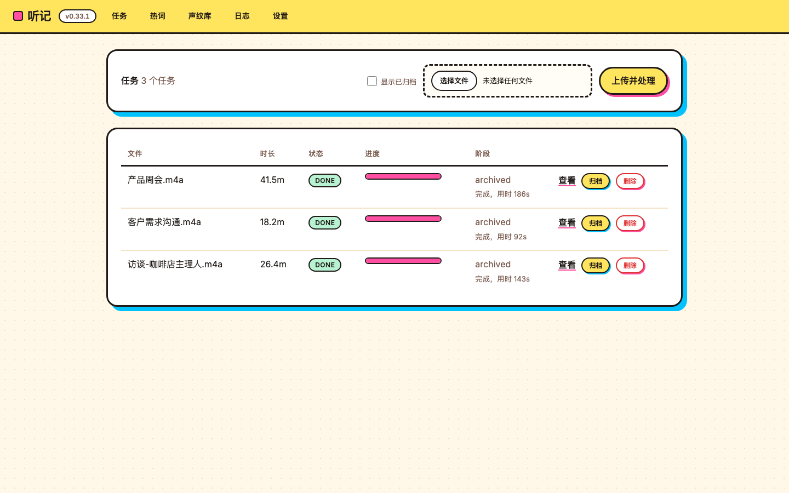
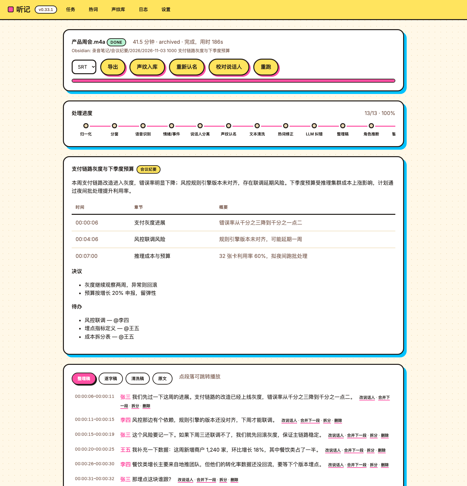
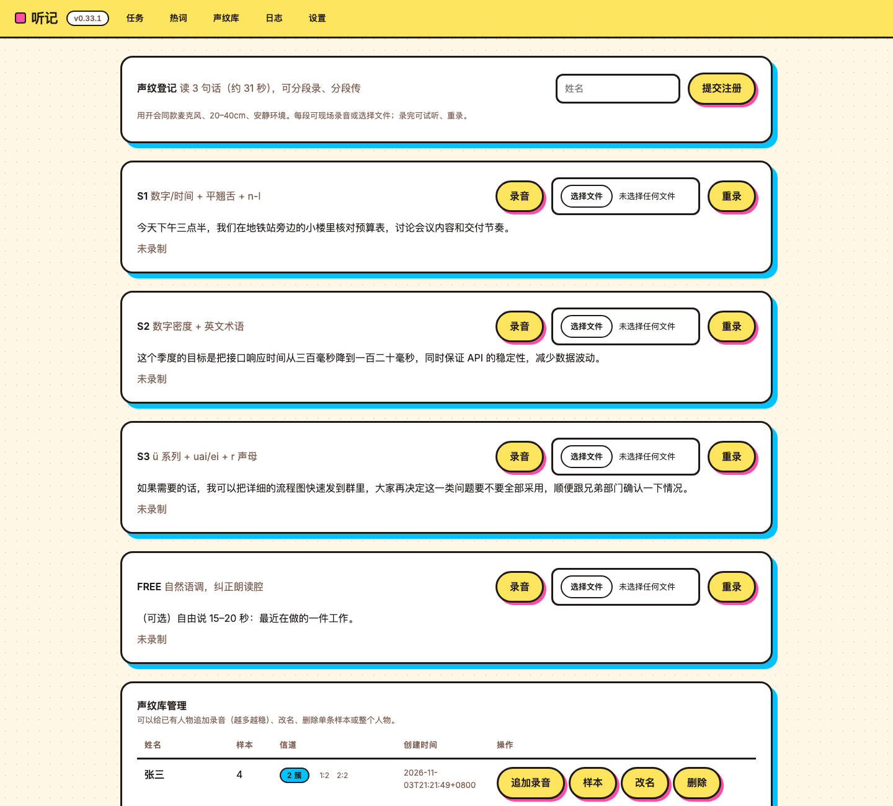

# 听记 · TingJi

**本地、离线、全流程的中文会议转写工具**：把录音丢进 `input/`，自动完成
「转写 → 说话人分离 → 声纹认名 → 去口水词 → 加标点 → 整理稿 → 摘要/章节/待办 → 归档到 Obsidian」，
并在浏览器里逐句校对、试听、改说话人。

数据不出本机，不需要任何云服务；LLM 环节可选（本地 Ollama）。



## 特性

| 能力 | 说明 |
|---|---|
| **离线转写** | FunASR Paraformer / SenseVoice / Fun-ASR-Nano 三引擎，按场景自动选 |
| **说话人分离** | sherpa-onnx 帧级分离（pyannote 分割 + CAM++ 声纹），支持重叠说话 |
| **声纹认名** | 网页录制 3 句话登记；按设备/信道聚类，跨设备也能认 |
| **文本整理** | 去口水词、数字规范化（`十五六个 → 15~16个`）、正则纠错规则、标点 |
| **逐字稿 / 整理稿** | 逐字稿保留原话与词级时间戳；整理稿由 LLM 分段润色 |
| **智能纪要** | 摘要、章节、决议、待办、关键词，按内容判定类型（会议纪要/日常对话/重要时刻…） |
| **Obsidian 归档** | `录音笔记/<类型>/<年>/<日期 标题>/`，笔记 + 音频 + 字幕放一起，逐字稿单独存 |
| **Web 校对** | 试听、改文字、改说话人、合并、**拆分**、删除、重跑、导出 SRT/VTT/TXT |
| **OpenAI 兼容接口** | `/v1/audio/transcriptions`，可直接接 Memos、Open WebUI 等客户端 |
| **自动化** | 监听 `input/`、队列处理、开机自启（登录项）、桌面通知/Webhook |

## 界面

| 任务详情 | 声纹库 |
|---|---|
|  |  |

## 快速开始

环境要求：macOS（Apple Silicon 推荐）/ Linux，Python 3.12，ffmpeg，可选 Ollama。

```bash
git clone git@github.com:yylqing/tingji.git
cd tingji

# 1. 虚拟环境（uv 或 python -m venv）
uv venv .venv-funasr --python 3.12
.venv-funasr/bin/python -m pip install -r code/requirements.txt   # 或用 uv pip install

# 2. 配置（首次可直接用默认值）
cp code/config/config.example.yaml code/config/config.yaml

# 3. 启动（自动监听 input/ 并开 Web）
PYTHONPATH=code .venv-funasr/bin/python -m app.cli service --port 8000
```

打开终端里打印的地址（形如 `http://127.0.0.1:8000/?token=xxxx`），
把音频拖进 `input/` 或在页面上上传即可。

> 令牌在 `code/config/access_token.txt`，首次启动自动生成。

## 目录结构

```
tingji/
├── code/            源码
│   ├── app/         程序（FastAPI + 流水线 + 引擎）
│   ├── config/      config.yaml / rules.txt / access_token.txt
│   ├── scripts/     安装自启、发版脚本
│   ├── tests/       单元测试（130+）
│   └── bench/       基准与引擎对比脚本
├── docs/            文档（选型、PRD、开发说明、使用手册、API）
├── input/           待处理音频
└── output/          产出 + .runtime/{data,work,logs,voiceprint}
```

> `.cache/`、`.pythons/`、`.venv-*/` 是隐藏的环境目录，保留在根。

## 常用命令

```bash
# 转写单个文件（默认 auto 选引擎）
PYTHONPATH=code .venv-funasr/bin/python -m app.cli run input/会议.m4a

# 指定引擎 / 说话人数
PYTHONPATH=code .venv-funasr/bin/python -m app.cli run input/会议.m4a --asr funasr --speakers 3

# 监听目录 + Web
PYTHONPATH=code .venv-funasr/bin/python -m app.cli service --port 8000

# 开机自启（macOS，登录项方式）
bash code/scripts/install-login-item.sh

# 单元测试
PYTHONPATH=code .venv-funasr/bin/python -m unittest discover -s code/tests
```

## 文档

| 文档 | 内容 |
|---|---|
| [使用手册](docs/10-使用手册.md) | 安装、界面、声纹/热词/设置、归档、故障排查 |
| [API 文档](docs/11-API文档.md) | OpenAI 兼容接口 + 内部 REST API |
| [技术选型报告](docs/01-技术选型报告.md) | 为什么选 FunASR / sherpa-onnx / Ollama，实测数据 |
| [PRD](docs/02-PRD.md) | 需求与验收标准 |
| [开发说明](docs/DEVELOPMENT.md) | 架构、流水线、踩坑记录、版本历史 |
| [界面设计规范](docs/08-界面设计规范.md) | Memphis 设计令牌 |
| [调研](docs/research/) | 同类项目拆解（Meetily / CapsWriter / Brevia / WhisprRT） |
| [变更日志](CHANGELOG.md) | 版本演进 |

## 配置

配置分层：`config/overrides.yaml`（Web 设置页写入） > `config/config.yaml` > 代码默认值。

常用项：

| 项 | 默认 | 说明 |
|---|---|---|
| `asr.provider` | `auto` | 会议→Paraformer，一对一对话→Nano |
| `diarization.backend` | `sherpa` | 帧级分离 |
| `diarization.match_threshold` | `0.35` | 声纹认名阈值（跨信道建议 0.30–0.45） |
| `diarization.channel_threshold` | `0.75` | 同一人样本按设备聚类 |
| `refine.enabled` | `true` | LLM 整理稿 |
| `summary.enabled` | `true` | LLM 纪要 |
| `obsidian.vault_path` | 空 | 填 vault 路径即启用归档 |
| `server.bind` | `0.0.0.0` | 局域网可访问（带令牌） |

## 常见问题

**Q：转写很慢？**
Paraformer 在 M4 上 RTF ≈ 0.05（1 小时音频约 3 分钟）；Nano 慢 3–10 倍。
可把 `asr.provider` 固定为 `funasr`。

**Q：说话人认不出来？**
换设备后声纹差异很大（同设备 0.9 → 跨设备 0.3）。建议每个常用设备各录 1–2 段，
或从真实任务里点「声纹入库」。

**Q：没有安装 Ollama 能用吗？**
能。把 `refine.enabled` / `summary.enabled` 关掉，其余功能不受影响。

**Q：开机自启没生效？**
macOS 用登录项方案：`bash code/scripts/install-login-item.sh`；
launchd 会因 `~/Documents` 的 TCC 限制失败（详见开发说明 §10.4）。

## 许可

MIT，见 [LICENSE](LICENSE)。

## 致谢

FunASR / sherpa-onnx / llama.cpp(Ollama) / pyannote / CAM++ 等开源项目；
部分工程思路参考了 Meetily、CapsWriter-Offline、Brevia、WhisprRT。
