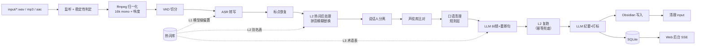
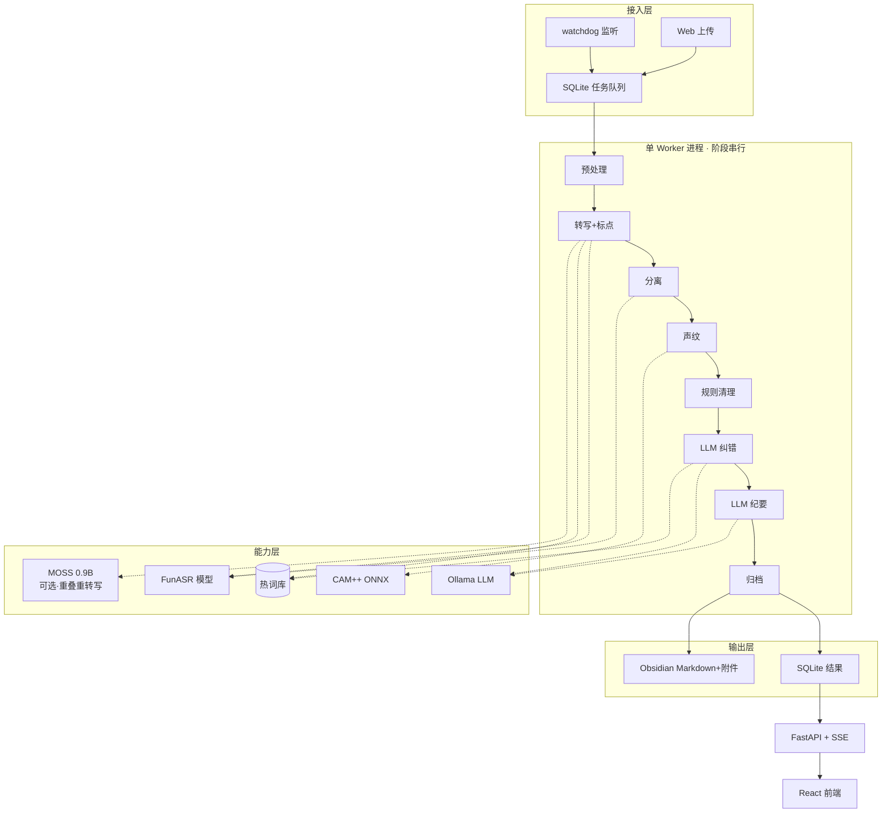

# 本地离线中文会议转写与纪要系统 · 技术选型报告

| 项 | 内容 |
|---|---|
| 文档版本 | v1.0 |
| 日期 | 2026-10-30 |
| 目标机器 | Apple M4 / 16GB 统一内存 / macOS 26.5.2 |
| 关联文档 | [PRD](02-PRD.md) · [实施计划](03-实施计划.md) · [开源方案调研](research/asr-stack.md) · [飞书妙记与 Obsidian 调研](research/feishu-obsidian.md) |
| 结论性质 | 所有性能数字均为**本机实测**；所有版本号均为**一手接口核对**（见调研文档）；无法实测的部分明确标注"未实测/估算" |

---

## 0. TL;DR

**一句话架构**：一个本地常驻的 Python 单体服务（FastAPI + SQLite + 单 Worker），用 `watchdog` 监听 `input/`，串行执行「预处理 → VAD → 转写 → 说话人分离 → 声纹比对 → 口语清理 → LLM 纠错重断句 → LLM 纪要 → Obsidian 归档」，通过 SSE 把进度推给浏览器。

**实测结论**：这台 M4 完全跑得动，而且余量很大。

| 环节 | 实测结果 | 判定 |
|---|---|---|
| 转写 + 标点 + 说话人分离（一体） | 39.57s 音频 → **1.86s**，RTF 0.047（**21× 实时**） | ✅ 远超需求 |
| 峰值内存 | **4.35GB**（ASR + VAD + 标点 + 声纹四模型同进程） | ✅ 16GB 可用 |
| 本地 LLM 纪要生成 | qwen3.5:9b 冷启动 5.4s、生成 288 token 用 18.8s（15.5 tok/s） | ✅ 可接受 |
| 1 小时会议端到端预估 | **7–10 分钟**（含纠错与总结） | ✅ 可接受 |

**三个关键取舍**（详见 ADR）：

1. **不选 Whisper 系**。M4 GPU 上 mlx-whisper turbo 只有 3.25× 实时，比 FunASR 的 CPU 路径慢 6.5 倍，中文错误还更多（实测把 "ClickHouse" 识别成 "PASPRO"、"迁移"→"践移"）。中文场景 FunASR 是压倒性优势。
2. **LLM 纠错必须是独立阶段，不能寄希望于"总结时顺手纠正"**。实测 qwen3.5 在总结时**原样照抄**了 ASR 的错误（"经营期间收息"、"接口连调"），因为摘要任务的目标是压缩而非校验。必须单独做逐句纠错，并喂术语表。
3. **转写文本双轨保留**（原文轨 + 清洗轨）。填充词删除是不可逆操作，"嗯/那个"有时承载语义（犹豫、指代），单轨会丢信息。清洗轨用于总结与导出，原文轨用于溯源与重跑。
4. **重叠说话只做"检测+标注"，不做"分离"**。单麦克风混合信号里不存在"谁的成分"这一信息；实测两人同时说话时 ASR 会串词并整体归给一人，目标说话人提取（VoxLock）后仍残留对方内容。详见 [04 文档 §1](04-重叠说话与声纹登记设计.md)。

---

## 1. 需求拆解与目标

### 1.1 需求 → 能力点映射

| 原始需求 | 拆解出的技术能力 | 优先级 |
|---|---|---|
| 上传音频到 input 文件夹即处理 | 目录监听 + 文件稳定性判定 + 入库去重 | P0 |
| 音频文字转写（wav/mp3/aac） | 解码归一化 + VAD + ASR | P0 |
| 人声分离 | 说话人日志（diarization） | P0 |
| 声纹识别 | 注册式声纹库 + 说话人命名 | P0 |
| 过滤无意义词（嗯/啊/额、无效重复） | 口语清理（规则 + LLM 双层） | P0 |
| 标点、断句 | 标点恢复 + 跨句重断句 | P0 |
| 按说话人列出，可选时间 | 结构化逐字稿 + 时间轴 | P0 |
| 交 LLM 总结汇总 | 结构化纪要生成 | P0 |
| 文本 + 音频存入 Obsidian | 文件写入 + 附件管理 + 标签 | P0 |
| 删除 input 中已处理音频 | 归档后清理（可配置） | P0 |
| 标签打标 | frontmatter tags + 自动打标 | P0 |
| 全程本地离线 | 无运行期外网依赖 | P0（硬约束）|
| Web 后台看进度与结果 | 队列页 + 详情页 + 实时进度 | P0 |
| 语义连贯通顺 | LLM 纠错 + 跨句合并 | P1 |
| 中文为主、夹少量英语 | 中英混说处理 + 术语表 | P1 |
| 对标飞书妙记 | 音频-文本联动、说话人改名、导出 | P2 |
| **两人同时说话** | 重叠检测 + 标注（不硬猜归属） | P0 |
| **声纹登记** | 登记文本 + 质检门控 + Web 向导 | P0 |

### 1.2 硬约束

| 约束 | 具体含义 | 对选型的直接影响 |
|---|---|---|
| **完全离线** | 运行期不发任何外网请求 | 排除所有云 API；模型必须本地落盘；LLM 必须本地推理 |
| **单机 16GB** | 峰值内存需 ≤ 10GB 才安全 | ASR 与 9B LLM 不能同时驻留，需分阶段加载/卸载 |
| **磁盘余量** | 实测仅剩 46GB，其中 Ollama 已占 54GB | 模型总量控制在 ~8GB 内；提供磁盘守卫 |
| **中文普通话 + 少量英语** | 主体中文，术语夹英文 | 决定 ASR 选型；决定必须有术语表机制 |
| **隐私** | 会议内容不出本机 | 反向强化离线约束，且日志需脱敏 |
| **单用户工具** | 不需要多租户、权限体系 | 不上 Postgres/Redis/Celery，SQLite 足够 |

### 1.3 量化验收目标

| 指标 | 目标 | 依据 |
|---|---|---|
| 端到端处理速度 | ≥ 5× 实时（1 小时音频 ≤ 12 分钟） | 实测 ASR 21×、LLM 后续开销后取保守值 |
| 中文 CER | ≤ 12%（无专名干扰场景） | FunASR 官方基准 Paraformer 10.18% |
| 专有名词/英文术语准确率 | ≥ 90%（含术语表与 LLM 纠错） | 需自建测试集校准 |
| 说话人数量误差 | ≤ ±1 人（≤ 8 人会议） | 实测样本正确，但样本量不足 |
| 时间戳漂移 | ≤ 0.5s（相对音频） | 纠错阶段只改文本不改时间 |
| 峰值内存 | ≤ 10GB | 16GB 留 6GB 给系统与浏览器 |
| 离线可用性 | 断网可完整跑通 | 硬性 |

---

## 2. 本机基线（实测）

### 2.1 硬件

| 项 | 值 | 对方案的影响 |
|---|---|---|
| 芯片 | Apple M4（10 核 CPU：4 性能 + 6 能效；10 核 GPU） | CPU 推理足够；GPU 只在 MLX 路线有收益 |
| 统一内存 | 16GB（实测 free 73%，swap 0） | 单阶段串行是安全做法 |
| 磁盘 | 228GB，可用 **40–46GB**（APFS 可回收空间浮动）；`~/.ollama/models` 已占 **54GB** | 需磁盘预算与清理建议 |
| Metal | Metal 4 支持 | MLX / PyTorch MPS 均可跑，但 FunASR 无 MPS 路径 |
| 显示 | 外接 4K@120Hz | 无影响 |

### 2.2 软件现状与踩坑记录

| 项 | 现状 | 问题 | 处理 |
|---|---|---|---|
| Python | Homebrew **3.14.6** 为默认 | PyTorch/torchaudio **无 3.14 轮子** | 用 `uv` 装 **3.12.13** 到项目内 `.pythons/`，不污染系统 |
| uv | 已安装 | 默认缓存写 `~/.cache/uv`，沙箱/权限受限时报 `Operation not permitted` | 设 `UV_CACHE_DIR`、`UV_PYTHON_INSTALL_DIR` 到项目内 |
| ffmpeg | 8.1.2 | 无 | 直接用 |
| Ollama | 服务端 **0.40.13**，CLI 客户端 0.32.3 | 版本不一致告警；`qwen3.5:9b` 实际 tag 是 `qwen3.5:9b-q4_K_M` | 按实际 tag 调用 |
| 已装模型 | qwen3.5:9b-q4_K_M(6.6G)、qwen3.6(23.9G)、deepseek-r1:8b/7b、qwen3.5:0.8b、nomic-embed-text 等 | `qwen3.6` 23.9GB 占盘过大 | 建议保留 9b 与 0.8b，其余按需清理 |
| Obsidian | **未安装**，未发现 vault | 不影响生成 Markdown；但 Dataview/callout 渲染需客户端 | 文档中给出 vault 路径配置项，默认占位 |

> **踩坑 #1（必记）**：`pip install torch funasr` 时若未锁 `torchaudio`，uv/pip 会装成 torch 2.6 + torchaudio 2.11，运行时 `dlopen` 报 `Symbol not found: _aoti_torch_abi_version`。**必须成对锁版本**（`torch==2.6.x` + `torchaudio==2.6.x`）。
>
> **踩坑 #2**：`mlx-whisper` 经 hf-mirror 下载时，新版 huggingface_hub 默认走 **Xet/CAS 协议**，镜像不支持 → `401 Unauthorized`。必须设 `HF_HUB_DISABLE_XET=1`。

### 2.3 网络可用性（实测，决定"能否装得上"）

| 源 | 结果 | 用途 |
|---|---|---|
| `pypi.tuna.tsinghua.edu.cn` | ✅ 2.4s | **首选 pip 镜像** |
| `mirrors.aliyun.com/pypi` | ✅ 5.0s | 备用 |
| `pypi.org` | ⚠️ 8s+，易超时 | 不用 |
| `www.modelscope.cn` | ✅ 0.38s，下载 12–14MB/s | **模型首选源** |
| `huggingface.co` | ❌ 超时（000） | 不可直连 |
| `hf-mirror.com` | ✅ 1.0s | HF 模型走此镜像 + 禁 Xet |
| `github.com` | ❌ 超时（000） | 网页与 API 不可用 |
| `objects.githubusercontent.com` | ✅ 0.75s | Release 资产可下（但**易断流**，需 `-C -` 续传） |
| `download.pytorch.org` | ⚠️ 根路径 403 | 按官方 index 安装，或直接用镜像的 torch 轮子 |

> **结论**：首次部署必须做"**离线预热**"——把模型一次性拉齐到项目内目录，之后运行期断网可跑。这是本方案可行性的前提，PRD 中列为必做功能（`make warmup`）。

### 2.4 实测基准

测试音频：用 macOS TTS 合成的 39.57s 中文"会议"，4 段发言、3 个可区分说话人，其中故意包含英文术语 `ClickHouse`。

| # | 方案 | 参数量/体积 | 设备 | 加载 | 推理 | RTF | 实时倍速 | 峰值 RSS |
|---|---|---|---|---|---|---|---|---|
| A | **FunASR**：SeACo-Paraformer-large + FSMN-VAD + CT-Punc + CAM++ | 2.1GB | CPU×10 | 14.1s | **1.86s** | **0.047** | **21.2×** | **4.35GB** |
| A' | 同上（**真实会议 1:12:55**） | 同上 | CPU×10 | 15.7s | 340.9s | 0.078 | **12.8×** | 4.87GB |
| B | **mlx-whisper** large-v3-turbo | 1.5GB | M4 GPU | ~1.5s | 12.16s | 0.307 | 3.25× | 1.76GB |
| C | **sherpa-onnx** 分离（pyannote-seg3.0 + CAM++ zh_en） | 34MB | CPU×4 | 0.17s | 1.26s | 0.032 | 31.4× | 223MB |
| D | **Ollama** qwen3.5:9b-q4_K_M 纪要 | 6.6GB | 统一内存 | 5.4s | 18.8s / 288tok | — | 15.5 tok/s | — |

方案 A 一次调用即产出：**带时间戳的句子 + 标点 + 说话人编号**。

> A' 是首次**真实多人会议**（73 分钟）验证：12.8× 实时、4.87GB，预算内，但慢于短音频 40%（段数多、声纹聚类开销）。真实数据同时暴露了 4 个合成音频测不出的问题（过度聚类、超长段标点崩溃、11% 无有效输出、英文术语系统性错识），已回写为 PRD 的 FR-B2/B4/B5.1/C1 修正。详见 [真实会议基线](research/real-meeting-baseline.md)。

**质量观察（这是选型的真正依据）**

- 方案 A 中文主体非常通顺，但**英文术语与同音字崩坏**：
  `ClickHouse` → "认批"/"标准查询"；`迁移` → "交移"/"经营"；`联调` → "连调"；`双写` → "收息"；`你出` → "拟出"。
- 方案 B 质量**更差**：`ClickHouse` → "PASPRO"，`迁移` → "践移"，`人事` → "人士"，还混入替换字符 `�`；分段粒度粗（30s 一段）。
- 方案 A 在该样本上**说话人数完全正确**（3 人，且跨段同一人被正确归并）；方案 C 在默认阈值下把 3 人并成 2 人（阈值 0.5–0.8 结果一致，0.9 收敛为 1 人），且分段过粗。
- **LLM 总结不会自动纠错**：把 A 的输出交给 qwen3.5:9b 做纪要，它在摘要里原样复述了"经营期间收息""接口连调"。→ 纠错必须是独立阶段。

**测试局限性（必须诚实说明）**

1. 音频为 TTS 合成，无背景噪声、无重叠说话、无远场混响，**不代表真实会议室条件**。
2. 各说话人之间**无停顿间隔**（直接拼接），对基于静音切分的分离算法不友好，方案 C 的欠分割可能与此有关。
3. 无人工标注测试集，**CER/DER 未测**，上述"错误观察"是抽样定性结论。
4. 结论用于判断**可跑性与数量级**，不用于判断**准确率排名**。正式选型前需用真实会议录音做一次小规模评测（见 [PRD §11 质量基准集](02-PRD.md#11-验收标准可执行)）。

### 2.5 LLM 关键行为（踩坑 #3）

`qwen3.5:9b` 是**思考型模型**。若用 `/api/generate` 且不设 `think: false`，思考内容会写进 `thinking` 字段并**吃光 `num_predict`**，`response` 返回空字符串——表现为"调用成功但没有输出"。实测 700 token 全部耗在思考上。

> 规则：所有结构化抽取/摘要调用一律 `"think": false`，并把 `num_predict` 设到 800+。

---

## 3. 能力拆解与候选方案对比

### 3.1 流水线总览



### 3.2 ASR（核心决策）

| 候选 | 中文 CER（官方基准） | 中英混说 | 时间戳 | 本机实测速度 | 许可 | 判定 |
|---|---|---|---|---|---|---|
| **FunASR Paraformer-zh (SeACo)** | 10.18% | 中（专名易错） | ✅ 原生词级 | **21× 实时** | MIT / 权重 Apache-2.0 | ✅ **主选** |
| FunASR SenseVoiceSmall | **7.81%** | 较好（整句语言 token） | ⚠️ 需开 `output_timestamp` | 同框架，快 | Apache-2.0 | ✅ 备选引擎 |
| FunASR Fun-ASR-Nano 800M | 8.06% | 好（26 口音/7 方言） | 支持 | **未实测**（LLM-ASR，CPU 预计偏慢） | Apache-2.0 | 🔶 P1 评估 |
| mlx-whisper large-v3-turbo | 21.71% | 中 | 段级（实测粗） | 3.25× 实时 | MIT | ❌ 否决 |
| faster-whisper / WhisperX | ~20% | 中 | 词级对齐 | 无 MPS，CPU 更慢 | BSD/MIT | ❌ 否决 |
| sherpa-onnx SenseVoice | 同 SenseVoice | 同 | ✅ 原生 | 快（ONNX int8） | Apache-2.0 | 🔶 轻量备选 |
| **MOSS-Transcribe-Diarize 0.9B** | AISHELL-4 14.84* | **好（热词实测有效）** | ⚠️ 原生但**重叠时乱序** | 约 2× 实时（CPU，实测 1.7–2.1×） | Apache-2.0 | 🔶 **重叠区间二次转写 + 高质量模式** |
| MOSS + GGUF/Metal | 同上 | 同上 | 同上 | 标称 28–30×（M4 Max，未验证） | Apache-2.0 | 🔶 P2 评估 |

\* MOSS 的 14.84 来自其官方评测（AISHELL-4），评测集/切分与 FunASR 的 184 文件基准不同，**不可跨表比较**。

> CER 数据来源：FunASR 官方 184 文件中文基准讨论帖（见 [asr-stack.md §1](research/asr-stack.md)）；MOSS 来自模型卡（见 [moss-transcribe-diarize.md](research/moss-transcribe-diarize.md)）。本机实测的速度与质量观察见 §2.4。

**选型**：主引擎 **Paraformer-zh (SeACo)**，理由：

1. 一次调用同时给「句子 + 时间戳 + 标点 + 说话人」，链路最短、状态最少；
2. 原生词级时间戳，满足"可选包含时间"与音频联动；
3. 支持**热词/SeACo 偏置**，可直接把项目术语、人名、英文专名注入，从源头降低错识；
4. 纯 Python wheel + torch CPU，无 gated 模型、无 HF 依赖。

**为什么不用 Whisper 补英文**：实测慢 6.5 倍且更差；且双引擎融合会引入对齐、去重、时间轴合并的大量复杂度，收益远小于成本。**用"三层热词 + LLM 纠错"解决英文术语问题更划算**。

**热词能力对比（本机实测，详见 [05 热词设计](05-热词登记设计.md)）**

| 引擎 | 模型级偏置 | 文本级后处理 | 实测效果（6 个专名） |
|---|---|---|---|
| **FunASR** | ✅ `hotword`（SeACo） | ✅ `postprocess_hotwords`（拼音+rapidfuzz，0.85） | 基线 4/6 → L1 5/6 → **L1+L2 6/6**，耗时 +0.06s/9.3s |
| **MOSS** | ✅ prompt 热词 | ❌ 需自建 | 基线 5/6 → **6/6**（含代词性别修正） |
| Whisper 系 | ⚠️ initial_prompt（弱） | ❌ | 不适用 |

> 结论：**FunASR 的"模型级 + 文本级"双层热词是当前最完整的**，这也是它继续做主引擎的又一条理由。MOSS 的 prompt 热词同样有效，但只有一层、且成本高（1.6× 实时）。

**P1 增强**：引擎可插拔（`asr.provider = paraformer | sensevoice | moss`），并按"试转 30s 估计英文占比 > 15% 则切 SenseVoice"自动路由。

**关于 MOSS-Transcribe-Diarize 0.9B**（详见[专项调研](research/moss-transcribe-diarize.md)）：文本质量与热词能力明显优于 Paraformer——实测热词把 `ClickHouse / 联调 / 双写 / 迁移` 全部修正，且在重叠说话时能把两人的话术分开（Paraformer 会缝成乱码）。但用 transformers 在 CPU 上只有 **约 2× 实时**（实测 1.7–2.1×，慢 10 倍），且**重叠段的时间戳会乱序**。因此**不作主引擎**，只用于：
1. 重叠区间的窗口重转写（替换原 VoxLock 方案）；
2. 用户显式选择的"高质量模式"；
3. 作为低置信片段的对照答案。

### 3.3 标点与断句

| 候选 | 说明 | 判定 |
|---|---|---|
| **FunASR CT-Punc** | 290M，随 ASR 一起调用，中英标点 | ✅ 主选（基础层） |
| LLM 重断句 | 跨句合并、长句切分、口语标点修正 | ✅ 主选（增强层） |
| sherpa-onnx 内置标点 | 覆盖有限 | ❌ |
| paddleNLP 标点 | 依赖链更重 | ❌ |

**选型**：`CT-Punc` 做基础标点（在 ASR 流水线内零成本），**LLM 做二次断句**，且严格约束"只改标点与句子边界，不改字词、不改时间戳"。

### 3.4 说话人分离

| 候选 | 粒度 | 本机实测 | 许可 | 判定 |
|---|---|---|---|---|
| **FunASR CAM++ 聚类**（随 ASR） | 句级 | 3 人样本正确；4.35GB 含全部 | Apache-2.0 | ✅ **主选** |
| sherpa-onnx（pyannote-seg3 + CAM++） | 帧级 | 31× 实时、223MB，但默认阈值欠分割 | Apache-2.0 | 🔶 可选增强 |
| pyannote.audio community-1 | 帧级 | 未测（需 HF token，gated） | 代码 MIT / 权重 CC-BY-4.0 | ❌ 不作硬依赖 |
| 3D-Speaker ERes2Net 自建 | 帧级 | 未测 | Apache-2.0 | ❌ 工程量过大 |

**选型**：句级聚类为主（够用、零额外依赖、与 ASR 同进程），**帧级方案作为 P1 可选增强**，仅在"重叠说话多/插话频繁"场景启用。理由：日会议录音以轮流发言为主，句级归属已能还原 90% 的可读性；帧级带来的复杂度（两个时间轴对齐、边界仲裁）与收益不成比例。

### 3.5 声纹识别（注册式）

**关键认知**：FunASR 的 `spk_model="cam++"` 输出的是**录音内匿名编号**，不是"注册后识别姓名"。官方文档明确建议注册场景另接 speaker verification。所以必须自建声纹库。

| 方案 | 维度 | 中文 EER | 说明 | 判定 |
|---|---|---|---|---|
| **CAM++ sv_zh_en advanced** | 192 | 6.78%（CN-Celeb） | 中英双语，27MB ONNX，无需 torch | ✅ **主选** |
| ERes2NetV2 | 192 | **6.14%** | 37.8MB，精度略高、略慢 | 🔶 备选 |
| ECAPA-TDNN（speechbrain） | 192 | — | 依赖链重 | ❌ |

**设计要点（避免踩坑）**：FunASR 的 PyTorch CAM++ 与 sherpa-onnx 的 ONNX CAM++ 是**不同导出**，embedding 不在同一空间，**不可混用**。因此：

- 分离用 FunASR 聚类得到匿名簇；
- 每个簇取若干代表句音频 → 用**同一个 ONNX CAM++**（`onnxruntime` 或 `sherpa-onnx` 的 extractor）重算 embedding → 求质心 → 与声纹库余弦比对；
- 注册、比对、簇质心全部在同一 ONNX 模型空间内完成，自洽。

**匹配策略**：top-1 余弦 ≥ 0.72 且与 top-2 差距 ≥ 0.05 才自动命名，否则留 `说话人N` 待人工确认（阈值需用真实数据校准，见 PRD 待决问题）。

### 3.6 填充词与重复清理

调研结论：**中文没有成熟的"填充词去除"开源工具**（英文有 disfluency removal 数据集与模型，中文基本空白）。因此自研。

| 层 | 手段 | 处理对象 | 可逆性 |
|---|---|---|---|
| L1 规则 | 词典 + 正则 + 位置判定 | 句首/句尾独立成词的"嗯/啊/额/呃/哦/那个/就是说/然后就是" | 保留原文轨 |
| L1 规则 | 叠词/结巴合并 | "我我觉得"→"我觉得"、"这这个"→"这个"、"对对对" | 保留原文轨 |
| L1 规则 | 纯填充段丢弃 | 清理后长度 ≤ 1 字且无实义词的整句 | 标记 `dropped` |
| L2 LLM | 上下文判定 | "那个"作指代 vs 作填充；重复整句的语义冗余 | 输出 diff，可回滚 |

**防误删设计**：`那个` 在"那个方案"里是指示代词，不能删。规则层只处理**独立成分**（前后有停顿/句读），LLM 层负责语境判定，并要求输出"删除位置 + 理由"。**最终展示双轨**：默认展示清洗轨，一键切原文轨。

### 3.7 语义连贯（LLM 纠错与重写）

这是"语义连贯通顺"需求的落点，也是全链路唯一有"创作性"的环节，必须严加约束。

**三层约束**：

1. **结构约束**：输入为带 `seg_id` 的 JSON 数组，输出必须是同 `seg_id` 集合的 JSON。**禁止增删 segment 编号**，禁止改时间戳。
2. **权限约束**：允许的操作只有 3 种——`replace`（改文本）、`drop`（整段删除并给理由）、`merge`（把 B 段并入 A 段，B 标记 `merged_into`）。时间戳继承被并入段。
3. **校验约束**：输出后做机器校验——`seg_id` 集合一致性、时间戳单调性、长度变化率（|Δlen|/len ≤ 0.5，超阈值告警）、是否引入原文没有的数字/人名（有则降级为 `suggest` 不自动应用）。

**分批策略**：按 ~2000 字或 30 段一批，批间携带**上一批最后 3 句作为上下文**，避免跨批语义断裂。

**术语表注入**：`glossary.yaml`（人名、项目名、英文专名、易错同音词）同时用于三处——ASR 热词、纠错 prompt、Obsidian 标签。

### 3.8 摘要与结构化

| 候选 | 体积 | 中文摘要质量 | 速度 | 判定 |
|---|---|---|---|---|
| **qwen3.5:9b-q4_K_M**（已装） | 6.6GB | 好（实测结构完整、JSON 合法） | 15.5 tok/s | ✅ **主选** |
| qwen3.5:4b | ~3.6GB | 够用 | 更快 | 🔶 纠错/打标用 |
| qwen3.6（已装，23.9GB） | 23.9GB | 更强 | 慢、占盘大 | ❌ 本机不划算 |
| deepseek-r1:8b（已装） | 5.2GB | 推理型，输出啰嗦 | 慢 | ❌ 结构化抽取不适用 |

**选型**：**纠错与打标用 4b，纪要总结用 9b**（错峰加载：先 4b 后 9b，用完 `keep_alive=0` 卸载）。全部走 Ollama HTTP API（`127.0.0.1:11434`），`think:false`。

**输出 schema**：`topic / participants / summary / chapters[] / decisions[] / todos[{owner,due,task}] / risks[] / keywords[] / tags[]`，用 JSON Schema 校验，失败重试一次（温度降到 0）。

### 3.9 文件监听与任务编排

| 候选 | 判定 | 理由 |
|---|---|---|
| **watchdog + 启动全扫 + 稳定性判定** | ✅ | 纯 Python、无外部依赖；全扫兜底"服务停机期间放入的文件" |
| 轮询 mtime（纯轮询） | 🔶 备选 | 简单但延迟高、长文件拷贝易误判 |
| n8n / Node-RED 工作流 | ❌ | ML 栈在 Python，跨进程传大文件得不偿失 |
| Celery + Redis | ❌ | 单用户场景过重，多两个常驻进程 |
| Prefect / Dagster | ❌ | 同上 |
| **SQLite 队列表 + 单 Worker + 状态机** | ✅ | 崩溃可恢复、天然串行（内存友好）、零额外进程 |

**文件稳定性判定**（防"拷贝到一半就被处理"）：文件大小连续 3 次采样（间隔 2s）不变 **且** 能独占读取 **且** `ffprobe` 能解析 → 才入队。同时用 `xxhash/md5` 去重（同一文件重复放入不重复处理）。

### 3.10 Obsidian 输出

| 决策 | 选择 | 理由 |
|---|---|---|
| 写入方式 | 直接文件系统写入（临时文件 + 原子 rename） | 无需 Obsidian 运行；原子写避免索引到半截文件 |
| 依赖插件 | **无硬依赖**（Dataview 可选） | 未装 Obsidian / 未装插件也能产出可读 Markdown |
| 附件位置 | `<vault>/attachments/audio/` 可配置 | 与 Obsidian "附件默认位置"设置对齐 |
| 音频格式 | 转码为 **m4a 64kbps**（原始保留可选） | vault 体积可控；m4a 兼容性好 |
| 时间戳跳转 | 纯文本 `[00:12:34]` + 可选 `#audio-time=` 链接 | Markdown 本身不支持音频 seek，需插件；不绑架用户装插件 |
| 幂等 | `job_id` 写入 frontmatter，重跑覆盖同一文件 | 避免产生重复笔记 |
| 标签 | 规则打标（日期/来源/时长/说话人）+ LLM 打标（项目/主题/会议类型） | 可控 + 智能结合 |

### 3.11 Web 后台

| 层 | 选型 | 理由 |
|---|---|---|
| 后端 | **FastAPI + uvicorn** | 异步、SSE 原生、自带 OpenAPI |
| 进度推送 | **SSE**（非 WebSocket） | 单向推送、断线自动重连、实现简单 |
| 存储 | **SQLite（WAL）** | 单机单用户足够；无需部署 |
| 前端 | **React + Vite + TS + Tailwind**，音频用 **wavesurfer.js** | 逐字稿高亮跟随、波形、点击跳转；妙记类交互必需 |
| 备选（MVP） | Jinja2 + Alpine.js | 若想 3 天出可点原型 |

### 3.12 音频预处理

| 步骤 | 工具 | 参数 | 目的 |
|---|---|---|---|
| 解码 | ffmpeg | 任意格式 → 16kHz/mono/pcm_s16le | ASR 输入规范 |
| 响度 | ffmpeg `loudnorm` | I=-16 LUFS | 远场/近距离混录时统一音量 |
| 降噪（可选 P1） | `arnndn` / `afftdn` | 轻度 | 空调噪声；过度降噪会伤声纹 |
| 切片 | 按 VAD 段 | 长静音不送 ASR | 省时间、防幻听 |

> 注意：**降噪默认关闭**。TTS/近场录音降噪有害；且降噪会改变声纹 embedding 分布，导致声纹库失配。仅在噪声明显时按任务开启。

### 3.13 OpenAI 兼容 API 的可行性

**结论：可以做，且不引入新依赖（FastAPI 足够），但必须解决"同步语义 vs 长任务"的矛盾。**

| 维度 | 评估 |
|---|---|
| 协议兼容 | ✅ `/v1/audio/transcriptions` 是标准 multipart，FastAPI 原生支持；`json/text/srt/vtt/verbose_json` 四种格式都能产出 |
| SDK 兼容 | ✅ `openai` Python SDK 只需改 `base_url`，`verbose_json` 多返回一个 `speaker` 字段不影响解析 |
| **同步限制** | ❌ OpenAI 是同步接口，客户端默认超时 60–300s；1 小时音频需 4.7–13 分钟，**必然超时** |
| 解决方案 | 音频 ≤30 分钟走同步（实测约 2.3 分钟）；>30 分钟返回 **202 + Location**，用扩展端点轮询 |
| 鉴权 | Bearer Key（sha256 存储）+ 限流；默认只绑 `127.0.0.1`，开放需显式配置 |
| 安全 | 只接受 multipart 文件（不收 URL）、扩展名白名单、`ffprobe` 校验、大小上限 4GB |
| 不做 | `/v1/audio/translations`、`stream=true`、`logprobs`、计费字段 |

> 详细契约见 [开发方案 §5.2](06-开发方案.md)。**默认不对外暴露**：绑定回环地址，需显式开启并配置 Key。

### 3.14 重叠说话（overlapping speech）

**结论**：不选"分离"，只选"检测"。理由与实测见 [04 文档](04-重叠说话与声纹登记设计.md)，此处只记选型判断。

| 候选 | 能力 | 本机实测 | 许可 | 判定 |
|---|---|---|---|---|
| 嵌入一致性检测（自研） | 段级"是否重叠" | 22 段样本上完全可分（基线最低 0.657 vs 混合段最高 0.626） | 自有 | ✅ **主选（L1）** |
| pyannote OSD | 帧级重叠区间 | 未测 | 代码 MIT / 权重 **gated** | ❌ 不作硬依赖，留作插件 |
| sherpa-onnx segmentation-3.0 powerset | 帧级人数（理论可表达双人） | 未测；`ExcludeOverlap` 丢弃重叠帧，CLI 不输出 overlap 标志 | Apache-2.0 | 🔶 P1 增强 |
| VoxLock 目标说话人提取 | 单目标提取后重转写 | 32.5s/5.56s；中文重叠下**仍残留对方内容** | Apache-2.0 | 🔶 P2 实验，默认关 |
| ClearerVoice MossFormer2 TSE | 目标提取 | 纯音频 TSE 无发布权重（只有需视频的 AV 版） | Apache-2.0 | ❌ 不可用 |
| SepFormer / ConvTasNet | 固定 2/3 人分离 | 未测；英语 WSJ0-2mix 训练，中文未评测 | Apache-2.0/MIT | ❌ 需固定人数、中文不可控 |

**产品取舍**：宁可在逐字稿里显示"多人同时说话"，也不给一个错的人名——错归属会把决议记到错误的负责人头上，比空着更有害。

---

## 3.17 ASR 输出后处理：幻觉过滤与静音门控

> 来源：[WhisprRT 路线调研](research/whisprt-realtime.md)。它做实时，我们不做实时，
> 但其中两个工程点对批处理同样成立，已落地。

### 3.17.1 幻觉过滤（P0，已实现）

ASR 在静音/音乐上会"编"内容。Whisper 系表现为固定套话（"优优独播剧场""请不吝点赞"），
FunASR 系主要表现为**纯标点段**（"。"）与**整段重复**。

| 判定 | 处理 | 理由 |
|---|---|---|
| 空 / 纯标点 | 整段丢弃 | 无信息，白占段落与 token |
| 套话黑名单（17 条中英正则） | 整段丢弃 | 典型幻觉 |
| 连续重复（tandem repeat） | **不丢**，交 `strip_repeats` | 真口吃也是内容（"一个一个一个小"） |
| 短句（"嗯。""是。"） | **不丢** | 真实应答；空格率问题由 `quality_flag` 负责 |

实测（6,853 段真实转写回放）：命中 **287 段纯标点（4.2%）**，零短句误杀。
> 第一版把"短"和"重复"也算幻觉，误杀 **14%**（"嗯/是"全被删），已修正。
> 教训：**过滤规则必须在真实语料上回放验证，不能拍脑袋**。

### 3.17.2 静音门控（P1，已实现）

文件级计算"有效语音占比"（30ms 帧 / 10ms 跳，能量高于自适应噪声底且过零率 <0.35），
低于 `asr.min_speech_ratio`（默认 2%）直接跳过识别。

| 输入 | speech_ratio | 结果 |
|---|---|---|
| 12.7 分钟真实对话 | 0.981 | 正常识别 |
| 60 秒纯噪声 | 0.0 | **跳过（1.2 秒完成，原需 20 秒）** |
| 60 秒静音 | 0.0 | 跳过 |
| 5 分钟对话 + 20 分钟静音 | 0.246 | 正常识别 |

**不做**实时转写（用户已明确不需要）。实时预览的评估见
[WhisprRT 调研 §4](research/whisprt-realtime.md)，结论：实时层与批量层可并存，但当前不做。

## 4. 选型决策矩阵

### 4.1 加权评分（ASR 主引擎）

权重：中文准确率 25 / 中英混说 15 / 时间戳 10 / 速度 10 / 内存磁盘 10 / 许可合规 10 / 离线完整性 10 / 集成成本 10。

| 候选 | 硬分（1–5 加权） | 结论 |
|---|---|---|
| FunASR Paraformer-zh (SeACo) | **4.55** | 主选 |
| FunASR SenseVoiceSmall | 4.45 | 备选/自动路由 |
| Fun-ASR-Nano 800M | 4.05 | P1 评估 |
| sherpa-onnx SenseVoice | 4.20 | 轻量部署备选 |
| mlx-whisper turbo | 3.10 | 否决 |
| WhisperX / faster-whisper | 2.90 | 否决 |

### 4.2 最终选型清单

| 能力 | 选定方案 | 版本 | 许可 | 备选 |
|---|---|---|---|---|
| 音频处理 | ffmpeg | 8.1.2 | LGPL/GPL | — |
| VAD | FSMN-VAD（FunASR） | 随 funasr 1.4.17 | Apache-2.0 | Silero VAD |
| ASR | SeACo-Paraformer-large | funasr 1.4.17 | MIT / 权重 Apache-2.0 | SenseVoiceSmall |
| 标点 | CT-Punc | 随 funasr | Apache-2.0 | LLM 断句兜底 |
| 说话人分离 | CAM++ 聚类（FunASR 内置） | 随 funasr | Apache-2.0 | sherpa-onnx 帧级 |
| 声纹识别 | CAM++ sv_zh_en advanced（ONNX） | sherpa-onnx 2.0.1 | Apache-2.0 | ERes2NetV2 |
| 填充词清理 | 自研规则库 + LLM | — | 自有 | — |
| 纠错/重断句 | Ollama qwen3.5:4b → 9b | ollama 0.40.13 | Apache-2.0 | qwen3.5:0.8b |
| 纪要总结 | Ollama qwen3.5:9b-q4_K_M | 同上 | Apache-2.0 | qwen3.6 |
| 编排 | SQLite + 单 Worker + watchdog | — | — | 纯轮询 |
| Web | FastAPI + React + wavesurfer | — | MIT/BSD | Jinja+Alpine |
| 归档 | 直接写 Markdown + 原子 rename | — | — | Obsidian URI |
| Python 运行时 | uv 管理的 CPython 3.12.13 | 3.12.13 | PSF | 3.11 |

### 4.3 被否决方案及原因（防止后来者重走）

| 方案 | 否决原因 |
|---|---|
| 全部用 Whisper 系 | 中文 CER 20%+，M4 上仅 3.25× 实时，实测质量更差 |
| pyannote.audio 作为硬依赖 | 权重 gated 需 HF token + 接受条款；CC-BY-4.0 需署名；无官方 MPS 支持；与"开箱即用离线"冲突 |
| FunASR `spk_model` 直接当声纹识别 | 官方明确它只是录音内匿名聚类，不是注册式验证 |
| 混合双 ASR（中文 Paraformer + 英文 Whisper） | 时间轴对齐、去重、冲突仲裁复杂度极高，收益被 LLM 纠错覆盖 |
| n8n / 工作流引擎 | ML 全在 Python，跨进程传音频/中间结果成本高于收益 |
| Celery + Redis | 多两个常驻进程，16GB 机器不划算 |
| 向量库（Chroma/Milvus）做检索 | 本期无检索需求（"跨会议搜索"是 P2），SQLite FTS5 够用 |
| 实时流式转写 | 需求是"上传文件后处理"，流式属另一条产品线 |
| 云端 ASR（阿里/讯飞） | 违反离线硬约束 |
| Python 3.14（系统默认） | torch 无 3.14 轮子 |

---

## 5. 推荐架构

### 5.1 分层



### 5.2 阶段定义（状态机）

| 阶段 | 输入 | 输出 | 失败影响 | 可单独重跑 |
|---|---|---|---|---|
| `ingested` | 原始音频 | 入库记录 + 校验 | 跳过 | ✅ |
| `normalized` | 原始音频 | 16k wav + 播放用 m4a | 后续全废 | ✅ |
| `transcribed` | 16k wav + 热词 | segments（文本+时间戳，已过 L1） | 后续全废 | ✅ |
| `hotworded` | ASR 原文 | 文本级热词替换（L2，含修正记录） | 用 ASR 原文 | ✅ |
| `diarized` | segments + wav | segments + spk 匿名 id | 无说话人标签 | ✅ |
| `identified` | spk 簇 + 声纹库 | spk → 姓名（可未命中） | 退回 `说话人N` | ✅ |
| `cleaned` | segments | 清洗轨 + diff | 用原文轨 | ✅ |
| `corrected` | 清洗轨 + 术语表 | 纠错轨（同 seg_id），随后 L2 再跑一遍 | 用清洗轨 | ✅ |
| `summarized` | 纠错轨 | 结构化纪要 | 无纪要 | ✅ |
| `archived` | 全部 | Obsidian 文件 + DB | 重试 | ✅ |
| `done` / `failed(reason)` | — | 终态 | — | 重跑 |

> **设计原则**：每个阶段的产物都落盘（`work/<job_id>/<stage>.json`），因此任何阶段失败可**从断点重跑**，不必从头。这对首次调参期极其重要（改 prompt 不用重跑 ASR）。

### 5.3 内存与磁盘预算

| 项 | 常驻/峰值 | 说明 |
|---|---|---|
| FunASR 四模型（ASR+VAD+Punc+spk） | **峰值 4.35GB** | 实测；处理完 `del` + `gc` 可释放 |
| CAM++ ONNX（声纹） | ~0.3GB | 可与 FunASR 并存 |
| Ollama 4b（纠错） | ~4GB | 与 FunASR **错峰** |
| Ollama 9b（纪要） | ~7GB | 与 4b **串行**，用完 `keep_alive=0` |
| Web 前端（浏览器） | 0.5–1.5GB | 不计入服务进程 |
| **安全峰值** | **≈ 10GB** | 16GB 下留 6GB 余量 |

**磁盘**（模型一次性）：

| 资产 | 体积 |
|---|---|
| SeACo-Paraformer-large | 953MB |
| CT-Punc | 1.1GB |
| FSMN-VAD | 3.9MB |
| CAM++（FunASR） | 28MB |
| CAM++ ONNX + pyannote-seg ONNX | 34MB |
| Python venv（funasr 栈） | 965MB |
| **合计** | **≈ 3.1GB** |

> 另需 Ollama 模型 6.6GB（已存在）。当前可用 46GB，**安全**；但 `qwen3.6`(23.9GB) + `deepseek-r1`(9.9GB) 建议清理，可回收 30GB+。

### 5.4 并发模型

**全链路串行**，理由：

- 内存：并行两个 ASR 就会 OOM；
- 正确性：声纹库比对需要稳定状态；
- 简单：单 Worker 天然幂等、易恢复。

**用户可感知的"并行"**：多文件在队列中排队，Web 显示 `排队中 / 处理中 / 已完成`；当队列 > 1 时，前一任务完成即自动开始，用户无需等待。

**唯一例外**：Obsidian 写入与 DB 更新可异步（IO 密集、毫秒级），但仍在同一 Worker 内顺序执行。

### 5.5 目录结构

```
voice-to-text/
├── input/                    # 待处理（用户投放）
├── work/<job_id>/            # 中间产物（stage json + wav）
├── archive/failed/           # 失败件（原文件移入，避免死循环）
├── data/app.db               # SQLite
├── models/                   # 模型（可挂外置盘）
├── config/
│   ├── config.yaml           # 主配置
│   └── glossary.yaml         # 术语表/热词
└── logs/
```

---

## 6. 架构决策记录（ADR）

**ADR-001｜单体 Python 服务 + SQLite 队列，而不是工作流引擎**
状态：已接受。
背景：用户提"应用/脚本/工作流"三种形态。约束：ML 全在 Python、单机单用户、16GB。
决策：FastAPI + 单 Worker + SQLite 队列表，进程内串行执行。
后果：少 2 个常驻进程；崩溃可恢复；代价是不能横向扩展（不需要）。

**ADR-002｜ASR 选 FunASR 而非 Whisper**
状态：已接受。
依据：实测 FunASR 21.2× 实时 vs mlx-whisper 3.25×；whisper 中文错误更多、分段更粗；FunASR 一次调用出时间戳+标点+说话人。
后果：牺牲"多语种泛化"，换取中文质量与速度；若未来需日语/粤语，加 SenseVoice 分支即可。

**ADR-003｜说话人分离先用句级聚类，帧级留作 P1**
状态：已接受。
依据：句级零额外依赖、与 ASR 同进程；日会以轮流发言为主。
后果：重叠说话/插话场景归属会错，需 P1 帧级增强。

**ADR-004｜必须引入独立的 LLM 纠错阶段**
状态：已接受。
依据：实测总结模型会原样照抄 ASR 错误，不会自动纠正。
后果：多一次 LLM 调用（约 1–3 分钟/小时音频），换专名与同音字正确率。

**ADR-005｜转写文本双轨（原文轨 + 清洗轨）**
状态：已接受。
依据：填充词删除不可逆，"那个/嗯"有时承载语义；调参需要可回滚。
后果：存储翻倍（文本很小，可忽略）；UI 需切换入口。

**ADR-006｜pyannote 不作硬依赖**
状态：已接受。
依据：模型 gated（HF token + 接受条款）、权重 CC-BY-4.0 需署名、HF 直连不可达、MPS 无官方支持。
后果：放弃可能的精度上限，换取"克隆即用、离线可跑、许可干净"。

**ADR-007｜watchdog + 启动全扫 + 稳定性判定，三重保险**
状态：已接受。
依据：单靠 watchdog 会漏掉停机期间文件；单靠轮询延迟高；大文件拷贝会被误判为就绪。
后果：多写一点状态判断，避免"处理了半个文件"这类脏数据。

**ADR-008｜Obsidian 采用原子写入（临时文件 + rename）**
状态：已接受。
依据：Obsidian 监听文件系统，半写文件会被索引成空笔记或触发冲突副本。
后果：需要同目录临时文件（`.tmp` 后缀），写入后 rename。

**ADR-009｜不引入向量库，不引入实时流式**
状态：已接受。
依据：本期无跨会议语义检索需求；实时流式是另一条产品线。
后果：跨会议搜索留 P2，用 SQLite FTS5 起步。

**ADR-010｜运行时锁 Python 3.12**
状态：已接受。
依据：本机默认 3.14 无 torch 轮子；3.12 是当前生态最稳。
后果：需 `uv python install 3.12` 并在项目内维护，不污染系统 Python。

**ADR-011｜重叠说话只做检测标注，不做语音分离**
状态：已接受。
依据：单麦克风混合信号中不含说话人归属信息；实测均衡重叠下 ASR 串词且整体归给一人；VoxLock（英语训练、无中文评测）提取后仍残留对方内容并引入新错误。业界（Otter）同样不做分离，靠人工改 label。
后果：逐字稿会出现"多人同时说话"的未归属段，需人工回听；换来的是**不产生错误归属**。分离能力保留为人工点选的 P2 实验功能。

**ADR-012｜声纹登记采用"3 句固定文本 + 六项质检"**
状态：已接受。
依据：CAM++ 是文本无关 embedding，固定文本的价值在于**音素覆盖**而非口令；实测 3 句 129 字覆盖声母 21/21、韵母 35/36、声调 5/5（99.1%），约 31 秒，符合 NIST SRE / Azure ≥20s 的注册下限。
后果：注册需约 30 秒跟读；换来更稳的模板质量。另提供 18 秒快速模式作为折中。

**ADR-013｜MOSS-Transcribe-Diarize 只做增强，不做主力**
状态：已接受。
依据：实测文本质量与热词能力显著优于 Paraformer（`ClickHouse/联调/双写` 全部修正），重叠说话也能分开内容；但 CPU 上仅约 2× 实时（FunASR 21×），且重叠段时间戳乱序。速度瓶颈在运行时（GGUF+Metal 标称 28–30×，未在本机验证）。
后果：主链路不变，只在"重叠窗口重转写"和"高质量模式"两处接入；若 GGUF PoC 达 8× 以上，再评估替换主引擎。

**ADR-014｜热词采用"三层注入"，L2 文本级后处理是必做项**
状态：已接受。
依据：实测同一段含专名的音频，无热词 4/6 正确；只加模型级偏置 5/6（"和坊街"仍非标准写法）；再加文本级拼音模糊替换（L2）后 6/6，耗时仅 +0.01s。L1 是软偏置改不彻底，L2 是确定性替换但需要 L1 先把音拉回可匹配范围，二者互补。
后果：ASR 阶段要维护一张热词表并注入两处；L2 必须在 LLM 纠错之后**再跑一遍**，防止模型把已修正的词改回去。

**ADR-015｜说话人分离改为独立阶段（不再依赖 ASR 内置 spk）**
状态：已接受。
依据：FunASR 内置 `spk_model` 是"整文件一次聚类"，无法跨分片、无法重算、无法干预；而 5 小时音频必须分窗处理。改为"VAD 全局切分 → 分窗 ASR → 全局 CAM++ 聚类"后，分片与说话人一致性解耦。
后果：多花 1–2% RTF（每段抽一次 embedding），换来可合并、可重跑、可复算，并让"短句不聚类 / 簇合并 / 双轮质心"有地方落地。

**ADR-016｜外部 API 采用"≤30 分钟同步、超过则 202 异步"**
状态：已接受。
依据：OpenAI 兼容接口是同步语义，但 5 小时音频需要 30–60 分钟处理，任何标准 HTTP 客户端都会超时。实测 RTF 0.078 → 30 分钟音频约 2.3 分钟，落在多数客户端超时之内。
后果：>30 分钟音频的调用方必须处理 202 + 轮询（已在文档中说明）；对外仍只绑回环地址，开放需显式配置 Key。

---

## 7. 风险登记册

| # | 风险 | 影响 | 概率 | 缓解 | 触发信号 |
|---|---|---|---|---|---|
| R1 | 16GB 内存下 ASR 与 9B LLM 并存导致 swap | 卡死 | 中 | 阶段串行 + `keep_alive=0` + 内存守卫（RSS>阈值暂停队列） | swap 非 0、系统卡顿 |
| R2 | 磁盘不足（模型 + 音频累积） | 处理失败 | 中 | 磁盘守卫（剩余 <5GB 告警并暂停）、音频转 m4a、清理 Ollama 冗余模型 | `df` 余量 <5GB |
| R3 | 中英混说专名错误率高 | 纪要失真 | **高** | 术语表热词 + LLM 纠错 + 归一化对照表；测试集回归 | 专名错误率 >10% |
| R4 | 说话人分离在真实会议（重叠/远场）失准 | 逐字稿不可读 | 中高 | 支持手动改名与合并；P1 帧级分离；`num_speakers` 提示 | 用户频繁改名 |
| R5 | LLM 纠错"过度改写"改变原意 | 内容失真 | 中 | seg_id 锁定 + 长度变化率校验 + diff 展示 + 一键回滚 | 长度变化 >50% |
| R6 | 声纹阈值不适配（误认/漏认） | 姓名错配（**隐私性错误**） | 中 | 双阈值 + margin + 人工确认；阈值可配 | 确认率低或误认投诉 |
| R7 | Obsidian vault 路径/同步冲突 | 笔记重复或丢失 | 低 | 路径校验、原子写、`job_id` 幂等、文档警告勿双同步 | 出现 Conflicted copy |
| R8 | 依赖版本漂移（torch/torchaudio 不匹配） | 装不上/跑不起来 | **高**（已踩） | 锁版本 + `uv.lock` + 安装后自检脚本 | import 报 dlopen 错 |
| R9 | HF 不可达导致模型拉不下来 | 首次部署失败 | 高（已证） | 一律走 ModelScope；必要时 hf-mirror + `HF_HUB_DISABLE_XET=1` | 下载卡住/401 |
| R10 | 长音频（>3h）内存与耗时 | 超时/OOM | 中 | VAD 分段流式处理、单段≤30s、结果增量落盘 | RSS 持续上涨 |
| R11 | Ollama 思考模型吞掉输出 | 静默失败 | **高**（已踩） | 强制 `think:false` + `response` 空则重试 | 响应为空但 HTTP 200 |
| R12 | 用户直接删除 input 中原文件与归档冲突 | 数据丢失 | 低 | 先归档成功才删除；`archive/failed` 兜底 | 归档失败但源已删 |
| R13 | 重叠检测阈值在真实数据上失准 | 误标/漏标 | 中高 | 阈值可配 + 基准集重标定 + 只标"可疑"不阻断流程 | 误报率 >10% |
| R14 | 声纹误认导致内容记到错误的人头上 | 决策错位（比缺省更糟） | 中 | 双阈值 + margin + 人工确认 + 重复注册拦截 | 用户频繁改回 |
| R15 | 声纹属生物特征，泄露风险 | 隐私 | 低 | 仅本地存储、可删除、导出不含向量 | 审计发现导出含向量 |
| R19 | 5 小时音频处理中断，前功尽弃 | 返工 | 中 | VAD 全局切分 + 分窗 ASR 逐窗落盘 + 阶段幂等重跑 | 任一大文件失败后需从头 |
| R20 | 外部 API 被同步调用拖死 | 服务不可用 | 中 | ≤30min 同步、超出 202；并发 1 + 队列上限；限流 | 出现超时堆积 |
| R21 | LLM 纠错占满 5h 时长的 47% | 体验差 | 高 | 选择性纠错（45% 批次）+ fast/standard/quality 三档 | 用户抱怨等待 |
| R17 | 热词 L2 过度替换（把正常词换成热词） | 文本失真 | 中 | 阈值 0.85 + 最小长度 + 误报统计 + 一键撤销 | 误报率 >5% |
| R18 | 热词过多稀释 L1 偏置 | 效果反而下降 | 中 | L1 上限 50 条 + 按权重截断 + A/B 验证 | 加词后 CER 上升 |
| R16 | MOSS 重叠段时间戳乱序、可能幻觉 | 时间轴错乱/脑补内容 | 中 | 混合方案只用其文本，时间用 VAD 重映射；无语音段强制丢弃 | 段落时间不单调 |

---

## 8. 依赖与安装

### 8.1 Python 依赖（建议锁定）

```toml
# pyproject.toml（节选）
[project]
requires-python = "==3.12.*"
dependencies = [
  "torch==2.6.*", "torchaudio==2.6.*",   # 必须成对，否则 dlopen 失败
  "funasr==1.4.17",
  "modelscope>=1.20",
  "sherpa-onnx==2.0.1",                   # 声纹 ONNX + 可选帧级分离
  "onnxruntime>=1.20",
  "soundfile>=0.12", "numpy<2.3",
  "fastapi>=0.115", "uvicorn[standard]>=0.32",
  "watchdog>=5", "httpx>=0.27",
  "pydantic>=2.9", "pydantic-settings>=2.5",
  "pyyaml>=6", "jinja2>=3.1", "python-multipart",
  "structlog>=24", "xxhash>=3.5",
]
```

### 8.2 模型清单（离线预热目标）

| 模型 | 来源 | 标识 | 体积 |
|---|---|---|---|
| ASR | ModelScope | `iic/speech_seaco_paraformer_large_asr_nat-zh-cn-16k-common-vocab8404-pytorch` | 953MB |
| 标点 | ModelScope | `iic/punc_ct-transformer_cn-en-common-vocab471067-large` | 1.1GB |
| VAD | ModelScope | `iic/speech_fsmn_vad_zh-cn-16k-common-pytorch` | 3.9MB |
| 声纹（聚类） | ModelScope | `iic/speech_campplus_sv_zh-cn_16k-common` | 28MB |
| 声纹（ONNX） | GitHub Release | `3dspeaker_speech_campplus_sv_zh_en_16k-common_advanced.onnx` | 27MB |
| 分离（可选） | GitHub Release | `sherpa-onnx-pyannote-segmentation-3-0.tar.bz2` | 6.9MB |
| 目标提取（可选） | GitHub Release | `sherpa-onnx-voxlock-int8.tar.bz2`（chunk 66MB + enroll 12MB） | 69MB |
| 增强转写（可选） | HuggingFace（走 hf-mirror） | `OpenMOSS-Team/MOSS-Transcribe-Diarize` | 1.82GB（GGUF Q4_K_M 仅 617MB） |
| 热词模糊匹配 | pip | `pypinyin` + `rapidfuzz`（FunASR 内置依赖路径） | ~5MB |
| LLM | Ollama | `qwen3.5:9b-q4_K_M`（已装）、`qwen3.5:4b` | 6.6GB / 3.6GB |

### 8.3 安装要点（踩坑清单）

```bash
# 1) Python 与镜像（项目内，不污染系统）
export UV_CACHE_DIR="$PWD/.cache/uv" UV_PYTHON_INSTALL_DIR="$PWD/.pythons"
export UV_INDEX_URL=https://pypi.tuna.tsinghua.edu.cn/simple
uv python install 3.12 && uv venv .venv --python 3.12

# 2) 模型源
export MODELSCOPE_CACHE="$PWD/models/modelscope"
export HF_ENDPOINT=https://hf-mirror.com HF_HUB_DISABLE_XET=1   # 仅首次预热

# 3) GitHub 资产易断流，务必续传
curl -L -C - --retry 3 -o campplus.onnx <url>

# 4) 安装后自检（必做）
python -c "import torch, torchaudio, funasr, sherpa_onnx; print('ok')"
python -c "import httpx; print(httpx.get('http://127.0.0.1:11434/api/version').json())"
```

### 8.4 离线验收

断开网络后执行一次完整处理（含 LLM 纪要），全链路成功即视为"离线达标"。CI 中以 `--no-network` 模式（拦截 socket 出站）自动校验。

---

## 9. 性能与容量模型（1 / 2 / 5 小时）

| 环节 | 耗时 | 依据 |
|---|---|---|
| 预处理（解码+重采样+响度） | 20–40s | ffmpeg 解 1h mp3 |
| VAD + ASR + 标点 + 聚类（含热词 L1） | **2.8–4.7 min** | 短音频 RTF 0.047；真实 73 分钟会议实测 RTF 0.078 → 60min ≈ 4.7min |
| 热词 L2 文本后处理 | **<1s** | 纯字符串匹配，实测 9.3s 音频 +0.01s，几乎为零 |
| 重叠段 MOSS 重转写（可选） | **+0–2 min** | 仅当用户手动触发；按重叠占比 <10% 估算 |
| 声纹比对 | <5s | 簇数 × ONNX 推理（毫秒级） |
| 规则清理 | <5s | 纯文本 |
| LLM 纠错（分 ~15–20 批） | 2–4 min | 4b，每批 ~300 输出 token |
| LLM 纪要 | 1–2 min | 9b，实测 288token/18.8s |
| Obsidian 写入 + 转码 m4a | 10–20s | — |
| **合计** | **≈ 6.5–10 分钟**（开启重叠重转写约 +2 分钟） | 约 **6–9× 实时** |

> 首次运行需加模型加载 15s 与 Ollama 冷启动 5–40s（视模型是否常驻）。

### 9.1 长音频容量模型（用户明确要求 1/2/5 小时）

以实测基线外推：73 分钟真实会议 = 341s 处理 / 4.87GB / 12.8× 实时 / 285 字/分钟；LLM 纠错实测 **0.069 秒/字**（全量，350 批/1434 秒/20,771 字）。

| 时长 | ASR | 说话人 | LLM 纠错（选择性 45%） | 纪要 | **合计** | **峰值内存** | 单任务磁盘 |
|---|---|---|---|---|---|---|---|
| 1h | 4.7 min | ~1 min | ~9.4 min | 1.5 min | **≈ 17 min** | 5.0GB | ~150MB |
| 2h | 9.4 min | ~2 min | ~18.8 min | 3 min | **≈ 33 min** | 5.2GB | ~300MB |
| 5h | 23.4 min | ~5 min | ~47 min | 7.5 min | **≈ 83 min** | 5.5GB | ~750MB |

**不做 LLM 纠错（`mode=fast`）**：1h ≈ 7 min、2h ≈ 14 min、5h ≈ 36 min。

**关键结论**：

1. **主链路内存基本恒定**（模型 2.1GB + batch 上限 + 段列表/embedding 线性但极小，5h 仅 ~8MB）。因此 16GB 可以支撑 5 小时以上。
2. **瓶颈是 LLM 纠错**（5h 下约 47 分钟，占 57%）。应对：
   - **选择性纠错**：只纠含英文/数字/低语速/热词命中的批次（实测命中约 45%）；
   - 长任务默认 `mode=standard`（规则清理，不做 LLM），用户可显式升到 `quality`；
   - 支持夜间批处理。
3. **MOSS 不能用于长音频**：内存按 **85MB/分钟**增长（1h≈5GB、2h≈10GB、5h≈25GB），16GB 机器**只支持 ≤1 小时**。必须按 `moss_max_audio_sec=3600` 硬限制。
4. **长音频必须能断点续跑**：VAD 全局切分 → 分窗 ASR → 逐窗落盘。架构调整见 [开发方案 §4.1](06-开发方案.md)。

---

## 10. 与飞书妙记的能力对齐

| 妙记能力 | 本项目 | 说明 |
|---|---|---|
| 上传音视频转写 | ✅ | input 投放 / Web 上传 |
| 说话人分离 | ✅ | 句级聚类 |
| 说话人改名 | ✅ | Web 改名，回写声纹库 |
| 重叠说话 | 🔶 | 检测 + 标注；可选 MOSS 窗口重转写（实测两人内容可分，时间戳需重映射） |
| 逐字稿 + 时间轴联动播放 | ✅ | wavesurfer + 段落高亮 |
| AI 智能纪要（总结/章节/待办） | ✅ | 结构化 JSON → Markdown |
| 关键词/标签 | ✅ | 规则 + LLM 打标 → frontmatter |
| 自定义热词 | ✅ | 三层注入（模型级 + 文本级 + LLM 术语表），实测专名 4/6→6/6；妙记未见此项（未确认） |
| 导出 txt/srt/md | ✅ | 内置三种 |
| 中英混说 | 🔶 | 需术语表，弱于妙记 |
| 云端协作/评论/分享 | ❌ | 本地单机，非目标 |
| 实时录制转写 | ❌ | 非目标（P3） |
| 多端同步 | ❌ | 依赖用户自己的同步方案 |

**差异化价值**：数据不出本机、无时长额度、可自定义 prompt 与术语表、产出直接进 Obsidian 知识库。

---

## 11. 结论

1. **技术上完全可行**，本机余量充足：ASR 21× 实时、峰值 4.35GB、1 小时会议 **6.5–10 分钟**出纪要。
2. **最终技术路线（三条引擎、各司其职）**

   | 场景 | 引擎 | 理由 |
   |---|---|---|
   | 全量转写 | **FunASR Paraformer + CAM++** | 21× 实时，速度不可替代 |
   | 重叠说话 | **MOSS 窗口重转写**（手动触发） | 唯一能把两人内容分开的本地方案 |
   | 高质量模式 | **MOSS 全量**（可选） | 文本与标点更好，代价约 30 分钟/小时 |
   | 专名正确性 | **热词三层注入** | 模型级 + 文本级 + LLM，实测 4/6 → 6/6 |

3. **真正决定可用性的不是 ASR 本身，而是"专名"与"说话人身份"**：
   - 专名靠**三层热词**（L2 拼音模糊替换是关键，几乎零成本，实测把 `沈知微/河坊街` 全部拉回标准写法）；
   - 身份靠**声纹库 + 人工确认**，且重叠段只标注不硬猜。

   两者都必须在 PRD 里作为一等功能设计，而不是事后补丁。
4. **工程风险集中在环境**（Python 版本、torch 版本配对、HF 不可达、Ollama 思考模式、MOSS 的 Xet/模块缓存），这些都已在 §2、§8 记录成清单，实施时应前置成安装脚本与自检。
5. **建议按 PRD 的 M0–M5 里程碑推进**：M0 骨架 → M1 转写 + 热词（**热词必须与转写同批做**，否则基准集建好才发现专名全错）→ M2 说话人 + 重叠标注 → M3 清理、纠错、纪要 → M4 Obsidian 闭环 → M5 打磨 + MOSS 重叠重转写。

---

*本报告所有实测数据可在 `bench/` 目录复现（脚本 + 原始结果 JSON）。*
