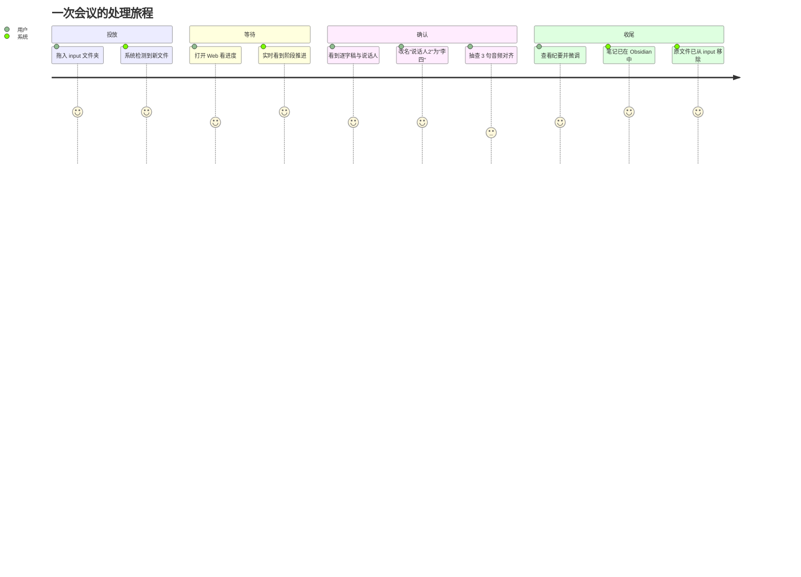
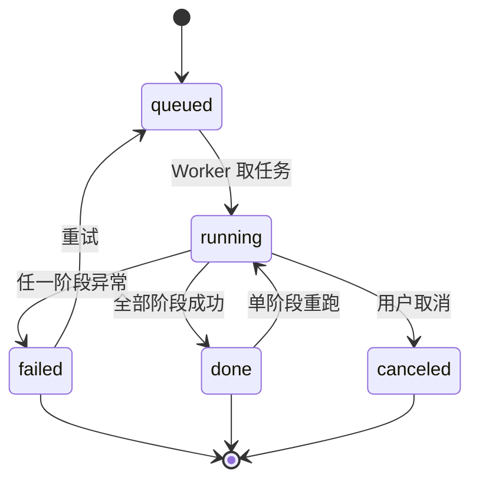

# PRD · 本地离线中文会议转写与纪要系统「听记 / TingJi」

| 项 | 内容 |
|---|---|
| 文档版本 | v1.0 |
| 日期 | 2026-10-30 |
| 状态 | 待评审 |
| 产品代号 | 听记（TingJi） |
| 关联文档 | [技术选型报告](01-技术选型报告.md) · [实施计划](03-实施计划.md) · [开源方案调研](research/asr-stack.md) · [飞书妙记与 Obsidian 调研](research/feishu-obsidian.md) |
| 目标平台 | macOS（Apple Silicon M4 / 16GB），本地单机 |
| 修订 | v1.0 首版：完整功能、交互、数据模型、Obsidian 规范、验收标准 |

---

## 1. 产品概述

### 1.1 一句话定位

**把"丢进文件夹的一段会议录音"变成"带说话人、带时间轴、带纪要的 Obsidian 笔记"，全程不联网。**

### 1.2 背景与问题

用户每周有 3–10 段中文会议/访谈录音（wav/mp3/aac），需要：

- 回看"谁在哪一分钟说了什么"——现有做法是反复拖动音频，效率极低；
- 整理成可检索、可链接的知识——录音躺在文件夹里就是死数据；
- 用 AI 总结，但**会议内容涉及内部项目与人事，不能上传云端**（飞书妙记/通义听悟均为云端处理，这是硬性排除项）。

现状的痛点排序（按用户访谈式推演）：

| # | 痛点 | 现状代价 |
|---|---|---|
| 1 | 找不到"谁说的" | 逐字稿只有文字，多个发言人混在一起 |
| 2 | 口语噪声淹没信息 | "嗯/啊/那个/就是说"占比 10–20%，读起来极累 |
| 3 | 转写错误需要人工逐句校对 | 专名、英文术语错误率高，纠错比重新听还慢 |
| 4 | 整理纪要耗时 | 1 小时会议整理成纪要 40–60 分钟 |
| 5 | 归档无结构 | 文件名混乱、无标签、无法按项目检索 |
| 6 | 云端工具不合规 | 数据出境/上云不可接受 |

### 1.3 产品目标

| 层级 | 目标 | 衡量 |
|---|---|---|
| 业务目标 | 把"1 小时会议 → 可用纪要"的人工成本从 60 分钟压到 **5 分钟以内**（只做校对与确认） | 用户实测时间 |
| 用户目标 | 打开 Obsidian 就能看到"结论 + 待办 + 可跳转逐字稿" | 每日使用率 |
| 技术目标 | 全链路离线、1 小时音频 ≤ 12 分钟处理完、峰值内存 ≤ 10GB | 见§9 |

### 1.4 非目标（明确不做）

- ❌ 实时录音转写（另立产品线）
- ❌ 多人协作、评论、分享链接（本地单机）
- ❌ 云端同步（用户自行用 iCloud/Obsidian Sync）
- ❌ 移动端 App
- ❌ 视频画面理解（只处理音轨）
- ❌ 跨会议语义问答（P3 再议）

### 1.5 成功指标

**北极星指标**：每周完成归档并"被打开过"的会议笔记数。

| 指标 | 目标值 | 采集方式 |
|---|---|---|
| 端到端成功率（不含用户取消） | ≥ 95% | `jobs` 表统计 |
| 平均处理倍速 | ≥ 6× 实时 | `finished_at - started_at` / `duration_sec` |
| 说话人自动命名命中率（已注册说话人） | ≥ 85% | `cluster_matches` 统计 |
| 用户逐字稿修改率（改动字数 / 总字数） | ≤ 8% | 编辑 diff |
| 纪要"直接可用率"（用户未改动词） | ≥ 70% | 编辑 diff |
| 单次人工介入时长 | ≤ 5 分钟/小时音频 | 用户自评 |

---

## 2. 用户与场景

### 2.1 用户画像

| 角色 | 描述 | 核心诉求 | 使用频率 |
|---|---|---|---|
| **P0 项目负责人（主用户，即本次需求提出者）** | 技术/产品负责人，每周多场内部会，重度 Obsidian 用户 | 会后 5 分钟内拿到可分发纪要；能追溯谁说的 | 每周 3–10 次 |
| P1 内容创作者 | 做访谈、播客素材整理 | 逐字稿要准、要能按说话人拆 | 每周 1–3 次 |
| P2 研究者/学生 | 访谈、讲座录音 | 长音频稳定、可导出、低成本 | 每周 1–2 次 |

### 2.2 核心场景（JTBD）

**S1｜日常项目周会（主场景）**
> 开完会，我把录音拖进 `input/` 文件夹，去泡杯咖啡。8 分钟后 Obsidian 里多了一篇笔记：三个人分别说了什么、达成了哪些决议、谁在什么时候前要交什么。我只需要改一下"说话人2"的名字。

**S2｜客户访谈复盘**
> 访谈 90 分钟，我需要在次日给团队同步。逐字稿按"客户/我方"分开，客户的原话能直接引用（因为保留了原文轨）。

**S3｜跨设备记录**
> 手机录的音（m4a）隔空投送到 Mac 的 `input/`，自动处理，笔记进 vault，iPad 上 Obsidian 同步后可读。

**S4｜历史补档**
> 把过去两个月的 20 个录音一次性扔进 `input/`，排队处理，第二天全部变成带标签的笔记。

### 2.3 用户旅程（主流程）



### 2.4 关键设计原则（贯穿全文）

| 原则 | 含义 | 体现在 |
|---|---|---|
| **不丢信息** | 任何自动删改都可回滚 | 双轨文本、diff 视图、原文轨常驻 |
| **可干预** | 机器不确定的地方让人一句话决策 | 说话人改名、待办确认、置信度提示 |
| **断点可续** | 任何阶段失败不必从头 | 阶段产物落盘、单阶段重跑 |
| **离线优先** | 运行期零外网 | 无 CDN、无遥测、模型本地 |
| **不改用户知识库结构** | 只增不改、命名可控 | 目录/标签全部可配，幂等写入 |

---

## 3. 竞品对标

### 3.1 飞书妙记能力拆解（对标基线）

| 能力 | 妙记现状 | 本项目 | 差异说明 |
|---|---|---|---|
| 导入 | 上传本地文件（≤4GB）、导入云文档、录制 | ✅ 文件夹投放 + Web 上传 | 本项目更"无感"（投放即处理） |
| 转写 | 中英日等多语，宣传 98% 准确率 | ✅ 中文为主 + 术语表 | 不追求多语种 |
| 说话人分离 | 自动区分，默认"说话人1/2/3"，可改名，会议室设备自动拆分 | ✅ 分离 + **声纹库自动认名** | 本项目在"固定团队"场景更强（注册一次，永久认名） |
| 重叠说话 | 未见公开说明（未确认） | ⚠️ 检测 + 标注，**不做分离** | 与 Otter 公开做法一致：同时说话无法判断归属，人工复核 |
| 逐字稿联动 | 点文字定位音频、倍速、跳过空白、搜索高亮 | ✅ 点击跳转 + 当前句高亮跟随 | 对齐 |
| 智能纪要 | 总结/章节/待办/关键词 | ✅ 同四件套 + 结构化 JSON | 对齐 |
| 关键词/高亮 | 支持高亮与关键词定位 | 🔶 关键词自动打标，手动高亮 P2 | 弱于妙记 |
| 导出 | 飞书文档/TXT/SRT，可选含说话人与时间戳 | ✅ Markdown/TXT/SRT/JSON | 本项目直出 Obsidian |
| 协作 | 评论、@、片段分享、权限 | ❌ | 非目标 |
| 离线 | 云端处理，无离线 | ✅ **全离线** | 本项目核心差异 |
| 成本 | 免费额度 + 会员 | ✅ 0 边际成本 | — |

### 3.2 其他竞品一句话

- **通义听悟**：能力强、有免费额度，但云端处理，且免费额度按天计。
- **腾讯会议转写**：绑定云录制与付费版，仅普通话。
- **Notta / Otter**：海外服务，中文与合规都不适用。

### 3.3 差异化定位

> 妙记是"团队协作的云端转写"，听记是"**个人知识库的本地转写**"。
> 前者卖协作与规模，后者卖**隐私、零成本、与 Obsidian 的原生融合**。

---

## 4. 功能需求总览

### 4.1 功能地图

```
听记
├── A 输入
│   ├── A1 文件夹自动监听
│   ├── A2 Web 手动上传
│   └── A3 文件校验与去重
├── B 转写
│   ├── B1 音频归一化
│   ├── B2 语音活动检测
│   ├── B3 语音识别
│   ├── B3.1 热词三层注入（模型级 + 文本级 + LLM）
│   ├── B4 标点与断句
│   └── B5 时间戳对齐
├── C 说话人
│   ├── C1 说话人分离（匿名聚类）
│   ├── C2 声纹库注册（三步向导 + 质检门控）
│   ├── C3 自动认名
│   ├── C4 手动改名/合并/拆分
│   ├── C5 声纹库回写
│   ├── C6 重叠说话检测与标注
│   └── C7 目标说话人提取（实验性，默认关闭）
├── D 文本加工
│   ├── D1 填充词清理
│   ├── D2 重复语句清理
│   ├── D3 LLM 纠错（同音字/专名）
│   ├── D4 LLM 重断句与跨句合并
│   └── D5 双轨对照与回滚
├── E 摘要
│   ├── E1 结构化纪要
│   ├── E2 章节切分
│   ├── E3 待办抽取
│   └── E4 自动打标
├── F 归档
│   ├── F1 Obsidian 笔记写入
│   ├── F2 附件（音频/SRT）写入
│   ├── F3 标签与 frontmatter
│   ├── F4 幂等更新
│   └── F5 源文件清理
├── G Web 后台
│   ├── G1 队列与统计
│   ├── G2 任务详情（播放器+逐字稿）
│   ├── G3 实时进度（SSE）
│   ├── G4 声纹库管理
│   ├── G5 热词库（登记/导入/试一段/治理）
│   ├── G6 设置
│   └── G7 日志与诊断
├── H 系统
│   ├── H1 任务状态机与断点续跑
│   ├── H2 内存/磁盘守卫
│   ├── H3 离线自检
│   ├── H4 通知（可选）
│   └── H5 长音频分窗处理（1/2/5 小时）
└── I 对外接口
    ├── I1 OpenAI 兼容转写接口
    ├── I2 API Key 与限流
    ├── I3 异步任务查询（扩展）
    └── I4 兼容性自检与文档
```

### 4.2 需求清单（含优先级）

| ID | 需求 | 优先级 | 阶段 |
|---|---|---|---|
| FR-A1 | 监听 `input/`，新文件自动入队 | P0 | M0 |
| FR-A2 | Web 上传（拖拽、多选） | P1 | M5 |
| FR-A3 | 文件稳定性判定 + 哈希去重 + 格式校验 | P0 | M0 |
| FR-A4 | 长音频（≤5h）分窗处理与断点续跑 | P0 | M2 |
| FR-B1 | 任意格式归一化为 16k mono wav + 响度归一化 | P0 | M1 |
| FR-B2 | VAD 切分 + 长段强制切分（>30s） | P0 | M1 |
| FR-B3 | 中文语音识别，输出带时间戳的句子 | P0 | M1 |
| FR-B3.1 | 热词三层注入（模型级/文本级/LLM） | **P0** | M1 |
| FR-B4 | 标点恢复 | P0 | M1 |
| FR-B5 | 词/句级时间戳，误差 ≤0.5s | P0 | M1 |
| FR-B5.1 | 低质量段过滤与标记 | P0 | M1 |
| FR-C1 | 分离说话人（短句不聚类 + 簇合并） | P0 | M2 |
| FR-C2 | 声纹注册（三步向导、3 句登记文本、六项质检） | P0 | M2 |
| FR-C3 | 自动认名（阈值 + margin） | P0 | M2 |
| FR-C4 | 改名/合并/拆分说话人 | P0 | M2 |
| FR-C5 | 改名后回写声纹库 | P1 | M2 |
| FR-C6 | 重叠说话检测与标注（不硬猜归属） | P0 | M2 |
| FR-C7 | 重叠段 MOSS 重转写（内容更准，时间重映射） | P1 | M5 |
| FR-D1 | 填充词清理（规则） | P0 | M3 |
| FR-D2 | 重复/结巴清理 | P0 | M3 |
| FR-D3 | LLM 纠错（同音字、专名、英文术语） | P0 | M3 |
| FR-D4 | LLM 重断句、跨句合并 | P1 | M3 |
| FR-D5 | 原文/清洗/纠错三轨对照 + 回滚 | P0 | M3 |
| FR-E1 | 结构化纪要（主题/概述/决议/待办/风险/关键词） | P0 | M3 |
| FR-E2 | 章节切分（带时间戳） | P1 | M3 |
| FR-E3 | 待办抽取（负责人/截止/任务） | P1 | M3 |
| FR-E4 | 自动打标（项目/主题/人物） | P0 | M4 |
| FR-F1 | 写入 Obsidian 笔记（原子写） | P0 | M4 |
| FR-F2 | 音频转 m4a + SRT + TXT 写入 | P0 | M4 |
| FR-F3 | frontmatter 与标签体系 | P0 | M4 |
| FR-F4 | 幂等更新（同 job 覆盖） | P0 | M4 |
| FR-F5 | 归档成功后删除 input 源文件 | P0 | M4 |
| FR-G1 | 队列页（状态/进度/统计） | P0 | M0 |
| FR-G2 | 详情页（播放器 + 逐字稿联动） | P0 | M1/M2 |
| FR-G3 | SSE 实时进度 | P0 | M0 |
| FR-G4 | 声纹库管理页 | P0 | M2 |
| FR-G5 | 热词库页面（增删改/批量导入/试一段/治理） | **P0** | M1 |
| FR-G6 | 设置页 | P0 | M4 |
| FR-G7 | 日志与失败诊断 | P1 | M5 |
| FR-H1 | 状态机 + 断点续跑 + 单阶段重跑 | P0 | M1 |
| FR-H2 | 内存/磁盘守卫 | P1 | M5 |
| FR-H3 | 离线自检 | P2 | M5 |
| FR-H4 | 系统通知（处理完成） | P2 | M5 |
| FR-H5 | 长音频容量守卫与预计完成时间 | P1 | M5 |
| FR-I1 | OpenAI 兼容 `/v1/audio/transcriptions` | P1 | M4 |
| FR-I2 | API Key 鉴权与限流 | P1 | M4 |
| FR-I3 | 异步任务查询（202 + Location） | P1 | M4 |
| FR-I4 | 兼容性自检（openai SDK 四格式） | P1 | M5 |

---

## 5. 详细需求

### FR-A 输入

#### FR-A1 文件夹自动监听（P0）

**描述**：服务启动后持续监听 `input/`，发现新增音频即入队。服务停机期间投放的文件，在启动时全量扫描补齐。

**规则**：
- 支持扩展名：`.wav .mp3 .aac .m4a .flac .ogg .wma .amr`（大小写不敏感），**视频文件可选**（`.mp4 .mov`，仅抽音轨）。
- 监听方式：`watchdog` 事件 + 30s 定时轮询兜底。
- 忽略：以 `.` 开头的隐藏文件、`.tmp/.part/.crdownload` 等临时后缀。

**验收**：
- Given 服务运行中，When 复制一个 mp3 到 input，Then 10s 内出现在 Web 队列，状态为"排队中"。
- Given 服务停止，When 放入 3 个文件后启动服务，Then 启动扫描后 3 个文件全部入队，且顺序稳定（按 mtime 升序）。

#### FR-A3 稳定性判定与去重（P0）

**描述**：避免处理"尚未拷贝完成"的文件，避免同一文件重复处理。

**规则**：
- 就绪判定：文件大小在连续 3 次采样（间隔 2s）内不变 **且** 能被独占打开 **且** `ffprobe` 能读出时长 > 0。
- 去重键：`sha256(文件内容)`；已在库中且状态非 `failed` → 标记 `duplicate`，不重复处理，UI 提示"已处理过，可查看原任务"。
- 校验失败 → 移入 `archive/failed/` 并记错误码，**不移除用户文件之外的东西**。

**验收**：
- Given 正在拷贝一个 500MB 文件，When 拷贝中途（已完成 30%），Then 系统不将其入队；拷贝完成后 10s 内入队。
- Given 同一文件被再次放入，Then 不新建任务，UI 提示重复并给出原任务链接。

#### FR-A4 长音频处理（P0，支持 1/2/5 小时）

**目标**：单文件最长 **5 小时**（可配），处理过程中内存不随时长线性增长，且中断后可续跑。

**处理方式**：VAD 全局切分 → 按约 25 分钟语音聚合为窗口 → 逐窗 ASR（逐窗落盘）→ 全局说话人聚类。

| 时长 | 预计耗时 | 峰值内存 | 中间磁盘 |
|---|---|---|---|
| 1h | ≈17 分钟（fast 模式 ≈7） | 5.0GB | ~150MB |
| 2h | ≈33 分钟（fast ≈14） | 5.2GB | ~300MB |
| 5h | ≈83 分钟（fast ≈36） | 5.5GB | ~750MB |

**规则**
- 入队前 `ffprobe` 读时长，估算耗时并显示在队列页（"预计 26 分钟"）。
- 单文件超过 `max_audio_sec`（默认 5h）→ 拒绝并提示分段。
- 任一窗口失败 → 只重跑该窗口，不影响已完成部分。
- 进度分两段：转写（按窗口数）、纠错（按批次数）。

**验收**
- Given 一段 5 小时音频，When 处理，Then 峰值内存 ≤6GB、进度单调、进程被 kill 后可从未完成窗口续跑。
- Given 2 小时音频处理到 60% 时断电，Then 重启后从上次窗口继续，不重跑 ASR。

#### FR-A2 Web 上传（P1）

支持拖拽与多选上传，显示上传进度，上传完成即入队。单文件上限可配（默认 4GB，对齐妙记本地文件上限）。

---

### FR-B 转写

#### FR-B1 音频归一化（P0）

- `ffmpeg` 解码为 **16kHz / 单声道 / pcm_s16le** wav（ASR 输入）。
- 同时生成 **m4a 64kbps** 作为 Obsidian 播放用附件（体积可控）。
- 响度归一化：`loudnorm I=-16 LUFS`（默认开启，可关）。
- 记录原始参数：时长、采样率、声道、码率、响度。

**验收**：Given 一个 44.1kHz 立体声 mp3，Then 产出 16k mono wav 与 m4a，时长误差 <0.1s。

#### FR-B2 VAD 与长段切分（P0）

- 使用 FSMN-VAD，输出语音段（起止 ms）。
- 参数可配：最小语音 200ms、最小静音 300ms、前后留白 100ms。
- 长静音（>2s）不送 ASR，节省算力并减少幻听。
- **长段强制切分（真实数据验证后新增）**：单段 > `max_segment_sec`（默认 **30s**）时，在段内能量谷处二次切分，再逐段送 ASR 与标点。

> **为什么必须有这条**：真实 73 分钟会议中 VAD 给出了一条 **280.7 秒**的段，CT-Punc 在该段上退化，全篇出现 **147 处**"单字被标点包夹"（如"这，个东西""然？后"）。见 [真实会议基线](research/real-meeting-baseline.md)。

**验收**：Given 一段 5 分钟连续独白，Then 输出中不存在 >30s 的单个 ASR 段，且标点异常率（单字被标点包夹）<1%。

#### FR-B3 语音识别（P0）

- 主引擎：FunASR SeACo-Paraformer-large。
- 输出：句子粒度文本 + 起止时间 + token 级时间戳（内部保留，用于词级高亮）。
- 可选引擎：SenseVoiceSmall（设置页切换）。
- **不得**对识别文本做静默修改；识别结果原样落盘为 `raw_text`。

**验收**：Given 39.57s 中文测试音频，Then 输出 15–25 个句子，每句有起止时间，首句起点 <1s，末句终点与音频时长差 <1.5s。

#### FR-B3.1 热词三层注入（P0）

> 详细设计与实测见 [05-热词登记设计](05-热词登记设计.md)。

**目标**：用户登记的人名/地名/宠物名/项目名/英文专名，在转写中"听得对、写得对"。

**三层分工（必须全部实现）**

| 层 | 注入点 | 参数 | 实测效果 |
|---|---|---|---|
| **L1 模型级** | FunASR 解码 | `hotword="沈知微 河坊街 …"`；MOSS 用 prompt `热词提示：…` | 沈志威 → **沈知微**（但"和坊街"仍非标准写法） |
| **L2 文本级** | 解码后 | `postprocess_hotwords={别名: 标准写法}` + `threshold=0.85` + 返回 matches | 和房街 → **河坊街**；两条全中 |
| **L3 语义级** | LLM 纠错 | 术语表注入 prompt | 代词性别、上下文拆分 |

**硬性规则**

1. **L2 必须运行两次**：ASR 之后一次（保证 LLM 看到正确的名字），LLM 纠错之后再跑一次（防止模型改回去）。
2. L2 只对 **≥2 个汉字或 ≥4 个字母** 的词做模糊替换，避免单字误伤。
3. L1 默认最多注入 **50 条**（按权重降序）；L2 支持到 2000 条。
4. 同一别名映射到多个热词 → **报冲突并拒绝保存**。
5. 每次替换都记录 `original / replacement / score / 位置`，供 UI 展示与撤销。

**配置**

```yaml
hotwords:
  enabled: true
  l1_max: 50
  l2_max: 2000
  l2_threshold: 0.85
  l2_min_len: 2
  inject_to_moss: true
  rerun_l2_after_llm: true
```

**验收**
- Given 登记 `沈知微 / 河坊街`（不填别名），When 重跑含这两词的音频，Then 输出为 `沈知微`、`河坊街`（基线 4/6 → 6/6）。
- Given 登记 50 条热词，When 处理 1 小时音频，Then 耗时增量 ≤3%。
- Given 某条 L2 修正被用户撤销，Then 该条误报计数 +1，且不因一次撤销就停用。

#### FR-B5.2 ASR 幻觉过滤（P0，已实现）

- 识别后、进入说话人/情绪阶段前，过滤"模型编造内容"：

| 类别 | 判定 | 处理 |
|---|---|---|
| 空 / 纯标点 | 无实义字符 | 整段丢弃 |
| 套话 | 17 条中英正则（优优独播剧场/请不吝点赞/感谢观看…） | 整段丢弃 |
| 连续重复 | 同一 1–6 字单元连续 ≥3 次 | **不丢**，交 `strip_repeats` |
| 短句 | "嗯/是/好" | **不丢**（真响应答） |

- 丢弃原因与样例写入事件日志（`payload` 保留前 20 条），便于回溯。

**验收**：Given 6,853 段真实转写，When 运行过滤，Then 丢弃率 3%–6%，且"嗯/是"类短句丢弃数为 0。

#### FR-B2.2 静音门控（P1，已实现）

- 解码后计算整段"有效语音占比"（30ms 帧、10ms 跳、自适应噪声底、过零率 <0.35）。
- 占比 < `asr.min_speech_ratio`（默认 0.02）且时长 >5s → 跳过识别，任务标记完成并写明原因。
- 占比写入事件日志，便于排查"为什么很快就跑完"。

**验收**：Given 60 秒纯噪声音频，Then 任务在 ≤3 秒内结束，状态为 done，message 含"未检测到有效语音"；
Given 正常对话，Then 占比 >0.5 且不影响识别。

#### FR-B4 标点（P0）

- 流水线内使用 CT-Punc 生成基础标点，**输入段必须 ≤30s**（见 FR-B2）。
- LLM 二次断句在 FR-D4 中完成，不在此阶段。
- 质量指标：单字被标点包夹的比例（如"这，个东西"）应 <1%。真实会议首跑为 **147 处 / 20,771 字**，是主要可读性缺陷。

#### FR-B5.1 低质量段过滤（P0，真实数据验证后新增）

对每个 ASR 段计算 `char_rate = 字数 / 时长`：

| 条件 | 标记 | 处理 |
|---|---|---|
| `char_rate < 1.0` 且 `时长 > 10s` | `low_quality` | 不进正文、不计入说话人统计；UI 显示"⚠️ 此段建议回听" |
| `char_rate < 3.0` 且 `时长 > 10s` | `suspect` | 保留但降权，不用于说话人聚类 |

> **真实数据依据**：73 分钟会议中有 **10 段、合计 8.2 分钟（11.2%）**满足低质量条件，最严重一段 280.7 秒仅输出 16 字。若不标注，用户会把"没识别出来"误当成"这段没人说话"。

**验收**：Given 一段 4 分钟静音/噪声，Then 该段被标记 `low_quality` 且不出现在逐字稿正文中，诊断页可见并给出时间区间。

#### FR-B5 时间戳（P0，已实现词级）

- **句级**：ASR 直接给出（Paraformer/SenseVoice 的 `sentence_info`）。
- **词级**：
  - Paraformer：`raw_text` 的空格分隔 token 与 `timestamp` **一一对应**，直接用（精确）；
  - SenseVoice：不返回 token 时间（实测 `timestamp` 为空），按字符数在句内均摊并标 `approx=1`；
  - 只对**原始转写**有意义——清洗稿删了口水词、整理稿是重写的，词与音频不再一一对应。
- 落库：`segments.words`（JSON 数组 `{t,s,e,approx}`）；接口 `/api/jobs/{id}` 返回；原文档位可点击跳转播放。
- 导出：`/api/jobs/{id}/export?format=srt&level=word` 生成逐词字幕。

**验收**：Given 任意带词级数据的任务，Then 原文轨每个词可点击、点击后播放器跳到该词起点（±100ms）；
Given `level=word` 导出，Then SRT 每条一个字/词，时间严格递增且落在所属句范围内。

#### FR-B5.0 时间戳（原条目，保留）

- 句级时间戳必填；词级时间戳保留在 `segments.tokens` JSON 中。
- 后续所有阶段**不得**修改时间戳；纠错阶段只改文本。

---

### FR-C 说话人

#### FR-C1 说话人分离（P0）

- 使用 CAM++ 聚类，输出 `spk_cluster`（0-based 整数）。
- 输出说话人数量、每人时长占比。
- 设置项：`diarization.max_speakers`（默认自动，可强制 2–10）。
- **短句不参与聚类**：只有 `≥ min_cluster_segment_sec`（默认 **1.0s**）的句子参与聚类；更短的句子按"前后同人则继承、否则归最近的长句"回填。
- **簇合并**：聚类后按质心余弦做连通分量合并（阈值默认 **0.72**），再展示给用户。

> **真实数据依据**：73 分钟会议首跑聚出 **10 个簇**（实际约 7 人），其中 **30.1% 的句子 <1 秒**；簇间相似度出现 S1~S8=0.852、S4~S7=0.734 的明显重复。加"短句不聚类 + 簇合并"后 10→7，句子被从中切断的现象消失。见 [真实会议基线](research/real-meeting-baseline.md)。

**验收**：
- Given 3 人对话录音，Then 至少识别出 3 个不同编号（允许 ±1 误差），且同一人跨段落的编号一致。
- Given 一段 70 分钟真实会议，Then 聚出的簇数不超过"人工估计人数 +1"，且不存在两个簇质心余弦 >0.85。

#### FR-C2 声纹注册（P0）

> 详细设计与实测依据见 [04-重叠说话与声纹登记设计 §6–§7](04-重叠说话与声纹登记设计.md)。

**三个入口**

| 入口 | 路径 | 适用场景 |
|---|---|---|
| 声纹库 → 新建 | `/voices/new` | 首次批量录入团队成员 |
| **任务详情 → 说话人 → "这是谁？"** | `/job/{id}` | **推荐**：声学条件与会议完全一致 |
| 上传音频文件 | `/voices/import` | 已有历史录音 |

**登记文本（3 句，129 字，约 31 秒）**

| # | 文本 | 设计意图 |
|---|---|---|
| S1 | 今天下午三点半，我们在地铁站旁边的小楼里核对预算表，讨论会议内容和交付节奏。 | 数字时间 + 平翘舌 + n/l |
| S2 | 这个季度的目标是把接口响应时间从三百毫秒降到一百二十毫秒，同时保证 API 的稳定性，减少数据波动。 | 数字密度 + 英文术语 + 前后鼻音 |
| S3 | 如果需要的话，我可以把详细的流程图快速发到群里，大家再决定这一类问题要不要全部采用，顺便跟兄弟部门确认一下情况。 | ü 系列 + uai/ei + iong/uang |

音素覆盖：**声母 21/21、韵母 35/36（仅缺 ueng）、声调 5/5，综合 99.1%**（可复现：`bench/phoneme_coverage.py`）。
另提供 15–20 秒**自由说话**（可选），用于捕捉自然语调，纠正朗读腔。

**三步向导（FR-C2.1）**：填基本信息 → 跟读（大字提词器、VAD 自动切句、逐句可重录）→ 质检报告 + 入库。

**质检门控（FR-C2.2，六项全过才入库）**

| # | 指标 | 默认阈值 |
|---|---|---|
| 1 | 有效语音时长 | 20–60s |
| 2 | 语音占比 | ≥60% |
| 3 | 估计 SNR | ≥15dB |
| 4 | 削波比例 | <0.1% |
| 5 | **单说话人校验**（用同一分离器自检，检出人数须 =1） | =1 |
| 6 | 句间自一致性（三句向量两两余弦） | ≥0.70 |

不通过时给出**具体动作**（如"检测到 2 人 → 请确认房间只有你"），而不是笼统失败。

**防重复注册（FR-C2.3）**：与库中**他人** top1 ≥0.80 → 弹窗提示"疑似已注册，是否合并"；与**本人**历史 <0.50 → 提示"换了设备或正在感冒？"。

**存储与匹配（FR-C2.4）**：每次会话产 3 个句向量 + 1 个 L2 归一化质心，带设备标签与质量分。同条件用质心比对，跨条件用逐向量 max 融合，取较高分。每人上限 6 个会话。

**快速模式（可选）**：仅 S1+S2（约 18s，音素覆盖约 88%），用于降低注册门槛。

**验收**：
- Given 按向导朗读 3 句（≥20s），Then 六项质检全部展示，通过后 3 秒内入库，声纹库出现卡片且可试听。
- Given 两人一起朗读，Then 第 5 项必须拦截。
- Given 已有人员的录音重复注册，Then 必须弹出"疑似重复"警告。

#### FR-C3 自动认名（P0）

**算法**：
0. **两轮策略**：第一轮用全部句子算质心并识别重叠段（FR-C6）；**剔除可疑重叠段后重算质心**，再进行比对——混合段会污染质心，实测会让所有段的聚类边距从 0.25–0.70 掉到 0.10 左右。
1. 对每个聚类簇，取其**时长最长的 3 个句子**（或合计 ≤60s）→ 重采样 → 用**同一 ONNX CAM++** 抽 embedding → 求质心。
2. 与该人物的所有注册向量比对，取最大余弦相似度。
3. 判定：`top1 ≥ 0.72` **且** `top1 − top2 ≥ 0.05` → 自动命名；否则保留"说话人 N"，标记 `needs_confirm`。
4. 同一任务内不允许两个人映射到同一人物（冲突时保留高分者，其余待确认）。

**UI**：命中的显示 `✅ 李四 (0.81)`；未命中的显示 `❓说话人2 (最高 0.63，可能是张三)`，提供一键确认按钮。

**验收**：
- Given 李四已注册，When 处理含李四的新录音，Then 该簇自动命名为"李四"，相似度显示在详情页。
- Given 两个未注册者，Then 保持"说话人1/2"，不误命名为已有人员（宁缺毋滥）。

#### FR-C4 手动干预（P0）

| 操作 | 说明 |
|---|---|
| 改名 | 把"说话人2"改为已有人员或新建人员 |
| 合并 | 把"说话人2"合并到"说话人1"（聚类过分割场景）。**系统应主动给出合并建议**（质心余弦 ≥0.72）|
| 拆分 | 把一个簇中误并入的句子选出来，拆为新簇（P1） |
| 批量改句 | 选中多句 → 批量改归属 |

所有操作记入 `events` 审计，并即时刷新 frontmatter 中的 `speakers`。

#### FR-C5 声纹回写（P1）

用户改名/确认后，询问"是否把这段声音加入该人声纹库？"（默认勾选）。加入后提升后续识别率。

#### FR-C6 重叠说话检测与标注（P0）

> **能力边界先说清楚**：两人同时说话时，单麦克风录音里不存在"谁的成分"这一信息，**无法分离**。本功能只做"检测 + 标注"，**不硬猜归属**。实测证据见 [04 文档 §1](04-重叠说话与声纹登记设计.md)。

**检测（FR-C6.1）**：对每个句子取 1 秒窗、0.5 秒跳，用 CAM++ 逐窗算 embedding，取段内两两余弦均值作为 `overlap_score`。
- `score < 0.62` → 强信号，标 `suspected`；
- `0.62 ≤ score < 0.70` 且聚类边距 `< 0.15` → 弱信号，标 `suspected`；
- 段长 <2s 无法计算 → 标 `unknown`，用边距兜底。

**归属决策（FR-C6.2）**：

| 情况 | 决策 |
|---|---|
| 一致性正常 | 按聚类结果归属 |
| 可疑 + top1 ≥0.75 且领先 ≥0.10 | 归给 top1，但保留"⚠️ 可能重叠" |
| 可疑 + 无明确优势 | **不归属**，显示"多人同时说话"，top-2 候选并列 |

**展示（FR-C6.3）**：逐字稿显示 `**多人同时说话** ⚠️ [00:04:07 · 4.1s]（可能是：张三 / 李四）`，正文保留 ASR 原文并提示"可能串词"，点击可播放该区间。

**用户操作（FR-C6.4）**：回听 / 指定说话人（含"两人都说"）/ **重转写此段**（触发 FR-C7）/ 手工拆分 / 忽略。

**配置**：`diarization.overlap_detect`（默认开）、`overlap_consistency_threshold`（0.62）、`centroid_refine`（默认开）。

**验收**：
- Given 本仓库重叠测试音频，Then 标出 4.1–11.9s 为"多人同时说话"，且不把该段归给任何单一说话人。
- Given 无重叠的基线音频（19 段），Then 误报数 = 0。
- Given 真实会议基准集，Then 重叠区间检出率 ≥70%、误报率 ≤10%（阈值据此重新标定）。

#### FR-C7 重叠段重转写（P1，手动触发）

**定位**：对"多人同时说话"的段，用端到端音频大模型重跑一次，拿到**更可信的文本与说话人**；**不是**自动环节，默认关闭。

- 引擎：MOSS-Transcribe-Diarize 0.9B（Apache-2.0，1.82GB，自回归同时输出文本 + `[Sxx]` 说话人）。
- 触发：用户在某个重叠段点"重转写此段"。
- 流程：
  1. 截取该段 **±3 秒**窗口（避免切断句子）；
  2. 送入 MOSS（带术语表热词），取回其文本与说话人；
  3. **丢弃 MOSS 的时间戳**（实测重叠时乱序），用原 VAD/FunASR 边界重映射；
  4. 与原文并排展示，标注"机器重转写，时间为估算"，由用户选择采用哪一版。
- 成本：实测 RTF 0.5–0.7，一段 10 秒重叠约 6–8 秒；按重叠占比 <10% 估算，每小时音频额外 **约 2 分钟**。
- 性能约束：不参与主链路，不并发（内存 5.7GB，需与 LLM 错峰）。

**实测依据**：同一段重叠音频，MOSS 能把两人的话术各自完整转出（S01 段无对方内容），而 FunASR 会缝成一句乱码；热词还把 `ClickHouse/联调/双写` 全部修正。详见 [MOSS 调研](research/moss-transcribe-diarize.md)。

**备选**：原 VoxLock 目标提取方案（69MB、6× 实时）因"提取后仍残留对方内容"降级，不再默认实现。

**验收**：
- Given 一个被标记为重叠的段落，When 点"重转写此段"，Then 60 秒内返回两人各自的文本，且**时间戳单调递增**（已被重映射）。
- Given 未开启该功能，Then 主链路耗时不受影响。

---

### FR-D 文本加工

#### FR-D1 填充词清理（P0）

**三层判定**：

1. **独立成分**（可删）：句子开头/结尾、被标点或停顿包围的
   `嗯 啊 额 呃 哦 唔 哎 唉 哈 那个 这个 就是说 然后就是 怎么说呢 对吧 是吧 你懂我意思吧`
2. **句中填充**（谨慎删）：`那个/这个` 在句中且前后无名词搭配 → 删；作指示代词（"那个方案"）→ 保留。
3. **语气保留**：句末的"啊/吧/呢"通常承载语气，**不删**（除非连续 ≥2 个）。

**输出**：`clean_text` + `changes[]`（类型、位置、原词、理由），供 UI 展示 diff。

**验收**：
- Given 句子"嗯，那个，我们这个季度的目标是翻倍啊。"，Then 清洗为"我们这个季度的目标是翻倍啊。"。
- Given 句子"那个方案我已经看过了。"，Then 保持原样（"那个"是指示代词）。

#### FR-D2 重复与结巴清理（P0）

- 叠词：`我我觉得` → `我觉得`；`这这个` → `这个`。
- 重复短句（相邻、相似度 ≥0.9、时长差 <3s）：保留时长更长的一条。
- 连续语气词 ≥3：保留 1 个。
- **整段丢弃**：清理后 ≤1 个汉字且无实义词 → `dropped=true`，保留在原文轨。

**验收**：Given 连续 5 个"对对对"，Then 保留 1 个"对"，其余标记删除原因。

#### FR-D3 LLM 纠错（P0）

**目标**：修正 ASR 的同音字、专有名词、英文术语，**不改变原意、不增删信息**。

**输入**：一批 segments（`seg_id` + 时间 + 说话人 + 文本）+ 术语表 + 全局上下文摘要（前序 3 句）。

**约束（必须写进 prompt 且代码校验）**：
- 只允许改字词与标点；**禁止**新增原文没有的事实、数字、人名。
- 无法确定的错误**不要改**，标注 `uncertain`。
- 输出 JSON：`[{seg_id, text, changed, reason}]`，`seg_id` 集合必须与输入一致。

**术语表注入**：`glossary.yaml` 中的 `term` 与 `aliases` 一并给出，要求"遇到读音相近的写成 term 的标准写法"。

**实测教训（写进实现要求）**：Ollama 思考型模型必须 `think:false`，否则输出为空。

**验收**：
- Given 含 `ClickHouse` 被识别为"认批"的句子，When 术语表含 `ClickHouse/认批/clickhouse`，Then 纠正为"ClickHouse"。
- Given 无错误句子，Then 保持原样（改动率 <5%）。

#### FR-D4 重断句与跨句合并（P1）

- 断句错误（一句话被切成 3 小段）→ 合并为一段，时间戳取首尾。
- 过长句（>80 字且无停顿）→ 在语义停顿处切分，**时间戳按字数比例插值**（标注为估算）。
- 一人连续多句且中间无他人发言 → 聚合为一个"发言块"展示（仅展示层合并，数据仍分句）。

**时间戳不变量（必须遵守）**

1. 时间戳**只能来自 ASR 句子边界**，LLM 输出中**禁止包含**任何时间数字。
2. 每个输出段落必须记录它覆盖的 `seg_id` 区间（`seg_start..seg_end`），段落时间取 `[首句.start, 末句.end]`。
3. 段落级时间必须**单调不重叠**；出现重叠即判定该批失败并回退。
4. Web 端点击段落 → seek 到该段起点；逐字稿原文轨保留**逐句**时间（不可被整理稿覆盖）。

> 实测：73 分钟会议整理后得到 324 段，时间全部来自 ASR 边界，0 处重叠，覆盖 64.3/65.3 分钟（差值为被丢弃的低质量段）。

**验收**：
- Given 一段被切成 3 段的同一句话，Then 展示为一整段，时间戳为 00:12–00:19。
- Given 任意整理稿段落，Then 其起止时间必须能在原始 ASR 句子里找到对应边界（不允许模型臆造）。

#### FR-D5 三轨对照与回滚（P0）

- 三轨：`raw`（ASR 原文）/ `clean`（规则清理后）/ `final`（LLM 纠错后，可人工编辑）。
- UI 顶部 tab 切换；默认展示 `final`。
- 每次切换显示行内 diff（删除红、新增绿）。
- "恢复原文"按钮：单句/整篇一键回退到 `clean` 或 `raw`。
- 人工编辑后 `final` 标记 `edited_by_user=true`，重跑纠错时**跳过**人工编辑过的句子。

---

### FR-E 摘要

#### FR-E1 结构化纪要（P0）

**输出 JSON**（schema 固定，前端按 schema 渲染）：

```json
{
  "topic": "会议主题（≤20字）",
  "summary": "150字以内概述",
  "decisions": ["决议1", "决议2"],
  "todos": [{"task": "...", "owner": "李四", "due": "2026-11-01", "evidence": "00:15 原话"}],
  "risks": ["风险1"],
  "keywords": ["关键词1", "关键词2"],
  "chapters": [{"start": "00:00", "title": "交付进度", "summary": "..."}],
  "tags": ["项目/数据平台", "主题/交付风险"]
}
```

**规则**：
- `owner` 必须来自已识别的说话人姓名（未命名则为"说话人N"）。
- `due` 若原话为相对时间（"周五之前"），**保留原话**并给出推算日期（`2026-11-01`），两者都要。
- 每个 `todo` 附 `evidence`（时间戳 + 原话片段）便于溯源。
- LLM 模型可配（默认 qwen3.5:9b），温度 0.2，`think:false`。

**验收**：
- Given 一段含 3 个明确决议的会议，Then `decisions` 至少覆盖 2 个，且每条能在逐字稿中找到依据。
- Given 输出非法 JSON，Then 自动重试 1 次（温度 0），仍失败则降级为纯文本摘要并标记 `degraded`。

#### FR-E2 章节（P1）

按语义转折与时间间隔切 3–8 个章节，每章给标题 + 一句话概括 + 起始时间，写入笔记的"章节"区。

#### FR-E3 待办抽取（P1）

待办在 Obsidian 中用 Tasks 插件兼容语法输出：
`- [ ] 出风险清单 @李四 📅 2026-11-01`

#### FR-E4 自动打标（P0）

| 来源 | 标签 | 示例 |
|---|---|---|
| 规则 | 类型 | `会议纪要` / `访谈` / `语音备忘录` |
| 规则 | 时间 | `2026/10` |
| 规则 | 时长档 | `时长/长会`（>60min） |
| 规则 | 来源 | `来源/本地录音` |
| 规则 | 说话人 | `说话人/李四` |
| LLM | 项目 | `项目/数据平台迁移` |
| LLM | 主题 | `主题/交付风险` `主题/招聘`（限 3–5 个，**必须从已有标签中优先复用**） |

**约束**：LLM 打标必须提供"已有标签列表"，要求优先复用，避免标签爆炸；新标签需用户可在设置中合并。

---

### FR-F 归档（Obsidian）

#### FR-F0 内容类型判定与命名（P0，已实现）

- 纪要阶段输出 `doc_type`（会议纪要/日常对话/重要时刻/访谈/讲座/备忘/其他）与 `title`（≤20 字）。
- 未启用纪要或 LLM 失败时，用结构启发式兜底（说话人数、时长、情绪占比）。
- 笔记文件名 = `{日期} {标题}`；归档目录 = `录音笔记/{类型}/{年}/{日期 标题}/`（每条录音一个文件夹，内含 md/音频/srt/txt）。
- 逐字稿单独放 `转写稿/{年}/`，笔记正文内嵌整理稿。
- frontmatter 写 `type` 与 `doc_type`，tags 含 `类型/{类型}`。

**验收**：Given 一段 2 人 10 分钟生活对话，Then 落盘到 `录音笔记/日常对话/<年>/` 且 tags 含 `类型/日常对话`；
Given 一段含哭泣的录音，Then `doc_type=重要时刻`。

#### FR-F1 笔记写入（P0）

- 路径：`<vault>/<笔记目录>/<YYYY>/<YYYY-MM-DD HHmm 标题>.md`（目录可配，默认 `会议纪要`）。
- **原子写**：先写 `xxx.md.tmp` → `fsync` → `rename`。避免 Obsidian 索引到半截文件。
- 文件名清洗：去除 `\ / : * ? " < > | # ^ [ ] %%`；长度 ≤ 80 字符；重名自动加 ` (2)`。
- 写入后可选调用 `obsidian://open?vault=<vault>&file=<path>` 让 Obsidian 弹出笔记（需已安装客户端）。

#### FR-F2 附件（P0）

| 附件 | 路径 | 命名 |
|---|---|---|
| 播放音频 | `<vault>/attachments/audio/` | `<YYYY-MM-DD HHmm 标题>.m4a` |
| 字幕 | 同上 | `同名.srt` |
| 纯文本 | `<vault>/attachments/transcripts/` | `同名.txt` |
| 原始音频（可选） | 同上目录 | `同名.<ext>`（默认**不保留**原始，只留 m4a） |

笔记中用 `![[attachments/audio/xxx.m4a]]` 嵌入播放器。

#### FR-F3 frontmatter 与标签（P0）

详见 §7.2 / §7.4。

#### FR-F4 幂等更新（P0）

- frontmatter 写入 `job_id`。
- 重跑/重新归档时：若目标文件存在且 `job_id` 相同 → 覆盖；不同 → 新建并加后缀。
- 绝不产生"同名两份"。

#### FR-F5 源文件清理（P0）

- **先归档成功**（笔记 + m4a + srt 均存在且非空）**才**删除 `input/` 源文件。
- 删除方式：移入废纸篓（`~/.Trash`，可用 `send2trash`）而非 `unlink`，保留 7 天可恢复。
- 设置项：`清理模式 = 移到废纸篓 | 硬删除 | 保留`（默认移到废纸篓）。
- 归档失败 → 源文件保留，任务标记失败并写明原因。

**验收**：Given 归档因 vault 路径无权限失败，Then input 中源文件仍在，任务状态为失败且提示"目标目录不可写"。

---

### FR-G Web 后台

#### FR-G1 队列页 `/`

**信息架构**：
- 顶部统计卡：今日已处理、处理中、排队、失败、累计时长、平均倍速。
- 任务列表（默认按创建时间倒序）：文件名、时长、状态徽章、进度条、当前阶段、用时、操作（查看/重跑/删除）。
- 筛选：全部 / 处理中 / 已完成 / 失败 / 重复。
- 空状态引导："把音频拖到 input 文件夹，或点这里上传"。

#### FR-G2 任务详情 `/job/{id}`

**布局**（左音频、右文本，可折叠）：

```
┌───────────────────────────────────────────────────────────┐
│ 周会：交付节奏与数据平台迁移     [已完成] 42:10  ·  用时 6:12 │
├──────────────────────────┬────────────────────────────────┤
│ ▶ 波形 + 时间轴           │ [纪要][逐字稿][章节][日志][导出] │
│ 00:00 ─────●───── 42:10   │                                │
│ 倍速 1.0x  跳过空白 ☑     │ 李四  00:03:21                 │
│ 说话人图例：              │ 目前我们有两个模块的进度落后了… │
│ ● 张三  ● 李四  ● 未知3   │ ─────────────────────────────  │
│                          │ 张三  00:03:45                 │
│                          │ 那这样，交付这块…               │
└──────────────────────────┴────────────────────────────────┘
```

**关键交互**：
- 点击任意句子 → 音频 seek 到该句起点并播放 3s（可配）。
- 播放时当前句高亮 + 自动滚动（可关"跟随播放"）。
- 说话人颜色区分（同一人固定色），点击图例可只看某人。
- 逐字稿顶部 tab：`纠错稿 / 清洗稿 / 原文`。
- 编辑：双击句子可改文本、改归属；改动即时保存（防抖 1s）。
- 说话人改名：点名字 → 下拉（已有人员 / 新建）→ 确认后全篇同步。
- 重跑：下拉菜单选择从哪个阶段重跑（转写/分离/纠错/纪要/归档），提示影响范围。

#### FR-G3 实时进度（P0）

- SSE 端点 `GET /api/events?job_id=...`，事件类型：
  - `job.status`（状态变更）
  - `job.stage`（阶段变更）
  - `job.progress`（0–100 + 阶段内百分比）
  - `job.log`（结构化日志行）
  - `job.done` / `job.failed`
- 断线自动重连；重连后先拉一次快照再增量。
- 阶段与进度映射：预处理 0–10%、转写 10–60%、分离 60–70%、声纹 70–75%、清理 75–80%、纠错 80–90%、纪要 90–96%、归档 96–100%。

#### FR-G4 声纹库 `/voices`

**列表页**
- 卡片：姓名、首字母头像、注册会话数、质量分、最近匹配时间、试听、删除。
- 顶部"未确认说话人"待办区：最近 N 个任务中未命中的簇，可一键关联。

**登记向导 `/voices/new`（三步）**

| 步骤 | 内容 | 关键交互 |
|---|---|---|
| 1 基本信息 | 姓名（必填）、角色、备注、"同步创建 Obsidian 人物笔记" | 姓名重复时提示 |
| 2 跟读 | 大字提词器（≥28px）、实时波形与电平、计时、"第 n/3 句" | VAD 检测 1.2s 静音自动切句；逐句可重录；可切"上传文件" |
| 3 质检入库 | 六项指标卡、问题定位与修复建议、与库中他人相似度 | 通过则"保存声纹"；不通过给出具体动作 |

- 录音用 `MediaRecorder`（webm/opus），后端 ffmpeg 转 16k wav。
- 刷新/关闭页面保留已完成句子（session 24 小时有效）；麦克风不可用时自动降级为上传。

**从任务登记（推荐）**：任务详情页说话人标签旁"这是谁？"→ 选已有人员或新建 → 该簇音频（≤60s）直接入库 → 立即重算本任务其余说话人匹配。

**合并人物**：同一人重复注册可合并，合并后模板全部保留。

#### FR-G5 热词库 `/hotwords`（P0）

**列表页**
- 表格列：标准写法、类型、别名、命中次数、误报率、启用、操作。
- 顶部统计：热词总数、本月命中、误报率、从未命中的条目数。
- 筛选：类型 / 范围（全局·项目）/ 仅看未生效；搜索。
- 误报率 >10% 的条目自动标 ⚠️ 并建议降权。

**新建/编辑**
- 字段：标准写法（必填）、类型（person/place/org/project/product/pet/english/other）、别名、拼音（自动生成，可覆盖多音字）、权重 0.1–2.0、适用范围（全局/项目）、备注。
- 勾选"同时创建 Obsidian 人物笔记"→ 生成 `人物/<姓名>.md`。
- 勾选"同时注册声纹"→ 跳转登记向导（FR-C2）。

**批量导入**
- 粘贴（一行一条，支持 `词` / `词,类型` / `词=>别名1,别名2`）、CSV/JSON 上传。
- 导入前预检：重复、别名冲突、类型缺失，逐条给结论。
- 支持从 Obsidian `人物/*.md` 的标题与 `aliases` 同步。

**试一段（必须做）**
- 录制 10s 或上传音频 → 并排显示"无热词 / 有热词"两版文本，修正处高亮，可逐条撤销。
- 后端实现：同一音频跑两遍 `generate`（约 2× 成本，9s 音频 ≈ 1s）。

**从纠错导入**
- 识别最近 N 个任务里反复出现的"原文→纠错"模式（≥2 次），在页面顶部提示候选词，一键加入。

**治理**
- 每条记录命中/误报；从未命中 → 提示"可能登记错了/没出现过"；误报高 → 自动降权。

#### FR-G6 设置 `/settings`

| 分组 | 项 |
|---|---|
| Obsidian | vault 路径、笔记目录、附件目录、音频格式、时间戳链接样式、写入后打开 |
| 处理 | 语言、ASR 引擎、是否降噪、响度归一化、最大说话人数 |
| 文本 | 填充词表、是否启用 LLM 纠错、纠错批次大小、是否重断句 |
| 摘要 | LLM 模型、提示词模板、章节数、标签前缀 |
| 声纹 | 相似度阈值、margin、自动命名开关 |
| 系统 | 并发度（固定 1）、内存上限、磁盘告警阈值、清理模式、保留原始音频 |
| 诊断 | 自检（依赖/模型/LLM/Obsidian 路径）、日志级别、打开日志目录 |

设置持久化在 `config.yaml`，Web 修改后热更新（重启 Worker 生效的项需提示）。

#### FR-G7 日志（P1）

结构化日志（JSON），可按任务过滤；失败任务显示"错误码 + 人话解释 + 建议动作"。

---

### FR-H 系统

#### FR-H1 状态机与断点续跑（P0）

- 阶段状态见 [技术选型 §5.2](01-技术选型报告.md)。
- 每阶段产物落盘：`work/<job_id>/{normalized.wav, transcript.json, diarization.json, cleaned.json, corrected.json, summary.json, export.json}`。
- 服务重启：扫描 `jobs` 表中非终态任务，从最后完成的阶段继续。
- 单阶段重跑：删除该阶段及之后产物，重新执行。

#### FR-H2 资源守卫（P1）

- 处理前检查：可用内存 < 2GB 或磁盘 < 5GB → 暂停队列并 UI 告警。
- 处理中：RSS 超过阈值（默认 10GB）→ 中止当前任务并标记 `resource_exhausted`。
- LLM 调用后主动卸载（`keep_alive=0`）。

#### FR-H3 离线自检（P2）

设置页"运行自检"：检查模型文件存在、LLM 端口可达、vault 可写、ffmpeg 可用、出站网络是否被调用（应为 0）。

#### FR-H4 通知（P2）

处理完成后 macOS 通知（`osascript`），点击跳转笔记。

### FR-I 对外接口（OpenAI 兼容）

> 详细契约见 [开发方案 §5.2](06-开发方案.md)。

**定位**：让外部脚本/工具（如截图工具、自动化流水线、其他 AI 客户端）把音频丢过来转写，不必调内部 API。**默认关闭对外暴露**。

#### FR-I1 转写接口（P1）

`POST /v1/audio/transcriptions`（multipart），字段与 OpenAI 对齐：

| 字段 | 支持 | 说明 |
|---|---|---|
| `file` | ✅ | 必填，≤4GB |
| `model` | ✅ | `tingji-asr`（默认）/`tingji-asr-hq`（MOSS，仅 ≤1h） |
| `language` | ✅ | `zh` 默认 |
| `prompt` | ✅ | 作为热词/上下文，≤500 字 |
| `response_format` | ✅ | `json`/`text`/`srt`/`vtt`/`verbose_json` |
| `timestamp_granularities[]` | ✅ | `segment`/`word` |
| `temperature` | ⚠️ | 接受但忽略 |

`verbose_json` 的 `segments[]` 额外带 `speaker` 字段（扩展，不影响标准客户端）。

**不包含 LLM 纠错**——保证响应时延可控；需要纠错的场景走内部任务。

#### FR-I2 鉴权与限流（P1）

- `Authorization: Bearer <key>`；Key 以 `sha256(key+salt)` 存储，明文只显示一次。
- 默认 `server.bind=127.0.0.1`；改非回环地址时**强制要求** `require_api_key=true`。
- 默认每 Key 10 次/分钟、并发 1；超限 429 + `Retry-After`。
- 文件大小、扩展名、可解码性三重校验；**不接受 URL**。

#### FR-I3 异步扩展（P1）

- 音频 ≤ `sync_max_audio_sec`（默认 1800s）→ 同步返回。
- 超过 → `202 Accepted` + `Location: /v1/audio/transcriptions/{id}`，body 含 `id/status/estimated_sec`。
- `GET /v1/audio/transcriptions/{id}` 查询；`DELETE` 取消。

#### FR-I4 兼容性自检（P1）

设置页提供"运行兼容性自检"：用官方 `openai` SDK 依次请求 `json/text/srt/verbose_json`，四项全通过才显示 ✅。

**验收**
- Given 用官方 openai SDK（仅改 base_url），Then 四种 response_format 全部正确返回。
- Given 无 Key 或错误 Key 访问非回环地址，Then 401。
- Given 一段 40 分钟音频，Then 返回 202 + Location，轮询可拿到结果。
- Given 一段 20 分钟音频，Then 同步返回且耗时 <5 分钟。

---

## 6. 交互与状态

### 6.1 任务状态机



**阶段（stage）**：`ingested → normalized → transcribed → diarized → identified → cleaned → corrected → summarized → archived`

### 6.2 进度语义

- `progress` 是**阶段加权的单调递增**值，不因单阶段重跑而回退（除非用户主动重跑，UI 明确提示）。
- 阶段内进度来自处理器的回调（如 ASR 按已处理音频秒数 / 总秒数）。
- 前端轮询兜底：SSE 断开时每 3s 拉一次 `/api/jobs/{id}`。

### 6.3 空态 / 错误态 / 边界态

| 场景 | 表现 |
|---|---|
| input 为空 | 引导语 + 示例用法 |
| 音频无人声 | 任务成功但标记"未检测到语音"，不写笔记（可配仍写空笔记） |
| 单人独白 | 分离返回 1 人，隐藏说话人筛选 |
| 音频损坏 | 失败，提示"无法解码"，源文件移入 `archive/failed/` |
| vault 不可写 | 失败，提示检查路径权限；源文件保留 |
| LLM 不可用 | 降级：跳过纠错与纪要，仍产出逐字稿与归档，标记 `degraded` |
| 磁盘不足 | 暂停队列 + 顶部红色横幅 |
| 超长音频（>3h） | 允许，但提示预计耗时；分段处理避免 OOM |

---

## 7. Obsidian 输出规范

### 7.1 目录结构

```
<vault>/
├── 会议纪要/
│   └── 2026/
│       ├── 2026-10-30 2230 周会-交付节奏与数据平台迁移.md
│       └── 2026-10-31 1000 客户访谈-某银行.md
├── 转写稿/
│   └── 2026/
│       └── 2026-10-30 2230 周会-逐字稿.md
├── 人物/
│   ├── 张三.md
│   └── 李四.md
└── attachments/
    ├── audio/
    │   ├── 2026-10-30 2230 周会.m4a
    │   └── 2026-10-30 2230 周会.srt
    └── transcripts/
        └── 2026-10-30 2230 周会.txt
```

> 说明：`人物/` 目录下的空笔记由系统**可选**创建（便于 `[[人物/张三]]` 不成死链），默认开启。

### 7.2 frontmatter 字段（笔记）

| 字段 | 类型 | 必填 | 示例 | 说明 |
|---|---|---|---|---|
| `type` | string | ✅ | `meeting-note` | 固定值，供 Dataview 过滤 |
| `job_id` | string | ✅ | `01JABCDEF...` | 幂等键 |
| `title` | string | ✅ | `周会：交付节奏与数据平台迁移` | LLM 生成，可编辑 |
| `date` | date | ✅ | `2026-10-30` | 会议日期（取文件 mtime 或文件名解析） |
| `start_time` | string | | `"22:30"` | 加引号避免被解析为时间 |
| `duration` | string | ✅ | `"00:42:10"` | 便于阅读 |
| `duration_sec` | number | ✅ | `2530` | 便于排序/统计 |
| `audio` | link | ✅ | `"[[attachments/audio/2026-10-30 2230 周会.m4a]]"` | 音频嵌入 |
| `transcript` | link | | `"[[转写稿/2026/2026-10-30 2230 周会-逐字稿]]"` | 逐字稿链接 |
| `srt` | link | | `"[[attachments/audio/2026-10-30 2230 周会.srt]]"` | 字幕 |
| `source` | string | | `input/2026-10-30-周会.mp3` | 原始文件名（不写绝对路径，防泄漏） |
| `speakers` | list[link] | ✅ | `["[[人物/张三]]", "[[人物/李四]]"]` | 已命名说话人 |
| `speaker_count` | number | ✅ | `3` | 含未命名 |
| `unnamed_speakers` | number | | `1` | 未命名数量，>0 时提醒 |
| `language` | string | ✅ | `zh-CN` | 检测/配置 |
| `tags` | list | ✅ | 见 7.4 | 标签 |
| `status` | string | ✅ | `完成` / `待校对` / `降级` | 便于看板筛选 |
| `confidence` | object | | `{asr: 0.91, diarization: 0.84, speaker_id: 0.77}` | 质量信号 |
| `engine` | object | | `{asr: "funasr-paraformer-zh", llm: "qwen3.5:9b-q4_K_M", app: "1.0.0"}` | 可复现性 |
| `created` | datetime | ✅ | `2026-10-30T22:45:12+08:00` | ISO 8601 |
| `updated` | datetime | ✅ | 同上 | 重跑时更新 |

### 7.3 正文结构

```markdown
> [!abstract] 一句话摘要
> 本次周会确认了 Q4 交付节奏、数据平台迁移方案与招聘计划，其中交付存在一周延期风险。

## 📌 决议
- 数据迁移采用灰度发布方案
- 交付风险清单由李四在周五前产出

## ✅ 待办
- [ ] 出交付风险清单 @李四 📅 2026-11-01 ^todo1
- [ ] 与 HR 对齐招聘计划 @张三 📅 2026-11-06

## ⚠️ 风险
- 接口联调阻塞导致两个模块延期约一周

## 🗂 章节
| 时间 | 章节 | 摘要 |
|---|---|---|
| 00:00 | 交付进度 | 两个模块延期一周 |
| 22:40 | 数据平台迁移 | 压测性能提升 3 倍，需解决双写一致性 |

## 📝 逐字稿
[[转写稿/2026/2026-10-30 2230 周会-逐字稿|查看完整逐字稿]]

> [!quote]- 片段预览（点击展开）
> **李四** · 00:03:21
> 目前我们有两个模块的进度落后了大概一周，主要是接口联调卡住了。

## 🎧 音频
![[attachments/audio/2026-10-30 2230 周会.m4a]]

## 🔗 相关
- 项目：[[项目/数据平台迁移]]
- 上期：[[2026-10-23 2230 周会]]
```

### 7.4 标签体系

**命名规范**：扁平层级 + 中文，`分类/值`，层级 ≤2 级。

| 分类 | 取值示例 | 来源 |
|---|---|---|
| 类型 | `会议纪要` `访谈` `语音备忘录` `课程` | 规则（设置默认 + 可手动） |
| 状态 | `待校对` `已校对` | 规则：有未命名说话人或用户编辑过 |
| 来源 | `来源/本地录音` `来源/手机录音` `来源/线上会议` | 规则 |
| 时长 | `时长/短会`(<30m) `时长/标准`(30–60m) `时长/长会`(>60m) | 规则 |
| 月份 | `2026/10` | 规则 |
| 人物 | `说话人/张三` | 声纹命名 |
| 项目 | `项目/数据平台迁移` | LLM（复用优先） |
| 主题 | `主题/交付风险` `主题/招聘` | LLM（3–5 个） |

**标签治理**：
- LLM 生成前注入"已有标签清单"，优先复用；
- 设置页提供"标签合并/重命名"；
- 单篇标签总数 ≤ 12（超过则丢弃最低分的主题标签）。

### 7.5 逐字稿笔记结构

```markdown
---
type: transcript
job_id: ...
audio: "[[...m4a]]"
parent: "[[会议纪要/2026/...]]"
tags: [转写稿]
---

## 逐字稿

**张三** `[00:00:00]`
各位同事，我们今天的周会主要讨论三件事。

**李四** `[00:00:11]`
我先说一下交付的问题。目前我们有两个模块的进度落后了大概一周。

**未知说话人3** `[00:00:22]`
我补充一下，数据平台这边我们已经用 ClickHouse 做了压测，性能提升了大概三倍。
```

**格式说明**：
- 时间戳括号可选（设置项 `时间戳样式`：`[HH:MM:SS]` / `[MM:SS]` / 关闭）。
- 同一人连续发言合并为一个块，块内按自然段。
- 可选"原文轨"以 callout 折叠附在每块后（设置项）。

### 7.6 Dataview 看板示例

```dataview
TABLE date AS 日期, duration AS 时长, speaker_count AS 人数, status AS 状态
FROM "会议纪要"
WHERE type = "meeting-note"
SORT date DESC
LIMIT 30
```

```dataview
TABLE WITHOUT ID file.link AS 会议, date AS 日期, tags AS 标签
FROM "会议纪要"
WHERE type = "meeting-note" AND contains(tags, "项目/数据平台迁移")
SORT date DESC
```

待办汇总（Tasks 插件）：

````
```tasks
not done
path includes 会议纪要
sort by due
```
````

> 若未安装 Dataview/Tasks，笔记本身仍完全可读——这是"无插件硬依赖"的设计要求。

### 7.7 音频时间戳跳转（现实约束）

Markdown 原生**不支持**音频 seek。三种可选方案（默认方案 1）：

1. **纯文本时间戳**（默认）：读者手动拖动，零依赖。
2. **插件方案**：`Audio Timestamp Player` 的 `[00:13](#audio-time=00:13)` 语法，或 `Media Extended` 的 `?t=` 参数；可在设置中开启"生成可点时间戳"。
3. **块引用方案（可选）**：实现可在每个章节标题行末写块 ID `^ch1`，章节表渲染为 `[[#^ch1\|00:22]]`，点击可定位到笔记内的该章节（定位文本，不定位音频）。默认关闭。

> 产品承诺：**不强制安装任何插件**。可点跳转是加分配置项。

---

## 8. 数据模型

```sql
-- 任务
CREATE TABLE jobs (
  id            TEXT PRIMARY KEY,            -- ULID
  source_name   TEXT NOT NULL,
  source_path   TEXT NOT NULL,               -- 相对 input/
  sha256        TEXT UNIQUE,                 -- 去重
  size_bytes    INTEGER,
  duration_sec  REAL,
  status        TEXT NOT NULL,               -- queued|running|done|failed|canceled|duplicate
  stage         TEXT,                        -- 当前阶段
  progress      INTEGER DEFAULT 0,
  error_code    TEXT,
  error_message TEXT,
  degraded      INTEGER DEFAULT 0,           -- 是否降级产出
  retry_count   INTEGER DEFAULT 0,
  config_snapshot TEXT,                      -- JSON
  created_at    TEXT, started_at TEXT, finished_at TEXT
);

-- 句子
CREATE TABLE segments (
  id            INTEGER PRIMARY KEY AUTOINCREMENT,
  job_id        TEXT NOT NULL REFERENCES jobs(id),
  idx           INTEGER NOT NULL,            -- 顺序
  start_ms      INTEGER NOT NULL,
  end_ms        INTEGER NOT NULL,
  raw_text      TEXT NOT NULL,               -- ASR 原文
  clean_text    TEXT,                        -- 规则清理
  final_text    TEXT,                        -- LLM 纠错 / 人工
  spk_cluster   INTEGER,                     -- 匿名聚类 id
  speaker_id    TEXT REFERENCES speakers(id),
  confidence    REAL,
  flags         TEXT,                        -- JSON: dropped|uncertain|merged_into|edited_by_user
  tokens        TEXT,                        -- JSON: 词级时间戳
  overlap_flag  TEXT,                        -- none|suspected|unknown|confirmed
  overlap_score REAL,                        -- 段内嵌入一致性 0-1
  spk_candidates TEXT,                       -- JSON: [{cluster, score}]
  UNIQUE(job_id, idx)
);

-- 重叠段重转写结果（FR-C7）
CREATE TABLE overlap_repasses (
  job_id     TEXT NOT NULL,
  start_ms   INTEGER NOT NULL,
  engine     TEXT,                           -- moss
  model      TEXT,
  text_by_spk TEXT,                          -- JSON: [{spk, text, start_ms, end_ms}]
  raw_output TEXT,                           -- 原始 [start][Sxx]text[end]
  used       INTEGER DEFAULT 0,              -- 用户是否采纳
  created_at TEXT,
  PRIMARY KEY (job_id, start_ms)
);

-- 重叠区间（供 UI 高亮与导出）
CREATE TABLE overlap_events (
  job_id     TEXT NOT NULL,
  start_ms   INTEGER NOT NULL,
  end_ms     INTEGER NOT NULL,
  candidates TEXT,                           -- JSON
  score      REAL,
  method     TEXT,                           -- embedding_consistency|margin|manual
  resolved   TEXT,                           -- auto|user|ignored
  PRIMARY KEY (job_id, start_ms)
);

-- 说话人（人物）
CREATE TABLE speakers (
  id           TEXT PRIMARY KEY,
  display_name TEXT NOT NULL,
  aliases      TEXT,                         -- JSON list
  note_path    TEXT,                         -- Obsidian 人物笔记
  created_at   TEXT
);

-- 声纹（一行 = 一个向量，可为句向量或质心）
CREATE TABLE voiceprints (
  id          INTEGER PRIMARY KEY AUTOINCREMENT,
  speaker_id  TEXT NOT NULL REFERENCES speakers(id),
  session_id  TEXT,                          -- 归属的登记会话
  kind        TEXT,                          -- sentence | centroid
  model       TEXT NOT NULL,                 -- campplus_sv_zh_en_16k
  dim         INTEGER NOT NULL,              -- 192
  vector      BLOB NOT NULL,
  quality     REAL,                          -- 0-1 质量分
  device_tag  TEXT,                          -- 采集设备/环境标签
  script_ver  TEXT,                          -- 登记文本版本
  source_job  TEXT,                          -- 从任务登记时记录
  created_at  TEXT
);

-- 登记会话（一次登记过程）
CREATE TABLE enrollment_sessions (
  id           TEXT PRIMARY KEY,
  speaker_id   TEXT NOT NULL REFERENCES speakers(id),
  status       TEXT,                         -- draft|recording|checking|committed|abandoned
  script_ver   TEXT,
  sentences    TEXT,                         -- JSON: 逐句音频路径与时长
  quality      TEXT,                         -- JSON: 六项指标
  free_speech_sec REAL,
  created_at   TEXT,
  committed_at TEXT
);

-- 聚类→人物匹配
CREATE TABLE cluster_matches (
  job_id     TEXT, cluster_id INTEGER,
  speaker_id TEXT,
  score      REAL, margin REAL,
  decision   TEXT,                           -- auto|confirmed|rejected|needs_confirm
  PRIMARY KEY (job_id, cluster_id)
);

-- 纪要
CREATE TABLE summaries (
  job_id TEXT PRIMARY KEY,
  model  TEXT, json TEXT, markdown TEXT,
  tokens_in INTEGER, tokens_out INTEGER,
  created_at TEXT
);

-- 归档
CREATE TABLE exports (
  job_id TEXT PRIMARY KEY,
  note_path TEXT, transcript_path TEXT,
  audio_path TEXT, srt_path TEXT, txt_path TEXT,
  tags TEXT,                                 -- JSON
  created_at TEXT
);

-- 事件/审计
CREATE TABLE events (
  id INTEGER PRIMARY KEY AUTOINCREMENT,
  job_id TEXT, ts TEXT, level TEXT, stage TEXT,
  message TEXT, payload TEXT
);

-- 热词库（替代早期设计的 glossary 表）
CREATE TABLE hotwords (
  id         INTEGER PRIMARY KEY AUTOINCREMENT,
  term       TEXT NOT NULL,                 -- 标准写法
  pinyin     TEXT,                          -- 自动生成，可覆盖（多音字）
  type       TEXT,                          -- person|place|org|project|product|pet|english|other
  aliases    TEXT,                          -- JSON ["沈志威","沈志微"]
  weight     REAL DEFAULT 1.0,              -- 0.1–2.0
  scope      TEXT DEFAULT 'global',         -- global | project:<id>
  enabled    INTEGER DEFAULT 1,
  source     TEXT,                          -- manual|bulk_import|auto_discovered|obsidian
  note       TEXT,
  created_at TEXT, updated_at TEXT
);
CREATE UNIQUE INDEX ux_hotwords_term ON hotwords(term);

-- 热词命中统计（治理用）
CREATE TABLE hotword_stats (
  hotword_id INTEGER, job_id TEXT,
  layer      TEXT,                          -- L1|L2|L3
  matched_at INTEGER, original TEXT,
  score      REAL, reverted INTEGER DEFAULT 0,
  created_at TEXT,
  PRIMARY KEY (hotword_id, job_id, layer, matched_at)
);

-- 配置
CREATE TABLE settings (key TEXT PRIMARY KEY, value TEXT);
```

**索引**：`jobs(status)`, `segments(job_id)`, `events(job_id, ts)`, `voiceprints(speaker_id)`。

**全文检索（P2）**：`segments` 建 FTS5 虚表供跨会议搜索。

---

## 9. 非功能需求

| 类别 | 要求 | 验证方式 |
|---|---|---|
| 离线 | 运行期无出站网络请求 | 断网跑通全流程；`--no-network` 模式 |
| 性能 | 1h 音频 ≤12 分钟；单句纠错延迟不影响体验 | 计时埋点 |
| 内存 | 峰值 ≤10GB；ASR 与 LLM 不共存 | 采样 `ps` + 告警 |
| 磁盘 | 处理前检查 ≥5GB；单任务中间产物 ≤3× 音频大小 | 守卫 + 清理策略 |
| 可靠性 | 崩溃后重启可续跑；不产生重复笔记 | 杀进程测试 |
| 幂等 | 同一文件重复处理不产生两份 | 哈希去重 + job_id |
| 可观测 | 每阶段有结构化日志与耗时 | 日志文件 |
| 隐私 | 日志不含音频内容与文本原文（默认脱敏）；无遥测 | 代码审查 |
| 生物特征 | 声纹仅存本地，UI 可见/可删；导出不包含声纹向量；删除人物即级联删除模板 | 数据库检查 |
| 可移植 | 除 Python/ffmpeg/Ollama 外无系统依赖 | 干净环境安装 |
| 启动 | 冷启动 ≤10s 可用（不含模型加载） | 计时 |

---

## 10. 错误处理与边界

| 错误码 | 场景 | 用户提示 | 系统动作 |
|---|---|---|---|
| `E_DECODE` | 无法解码音频 | 文件可能已损坏或格式不支持 | 源文件移入 `failed/` |
| `E_NO_SPEECH` | 未检测到人声 | 未检测到语音内容 | 完成任务、标记、不写笔记 |
| `E_MODEL_MISSING` | 模型文件缺失 | 缺少模型，请运行 `make warmup` | 暂停队列 |
| `E_LLM_DOWN` | Ollama 不可达 | 本地模型服务未启动 | 降级产出逐字稿 |
| `E_LLM_EMPTY` | 输出为空（思考模式） | 模型未返回内容，已重试 | 自动重试 + 关思考 |
| `E_LLM_JSON` | JSON 非法 | 纪要生成失败 | 重试一次，仍失败降级纯文本 |
| `E_VAULT_UNWRITABLE` | vault 不可写 | 目标目录不可写，请检查路径 | 保留源文件 |
| `E_DISK_FULL` | 磁盘不足 | 磁盘空间不足 | 暂停队列 |
| `E_OOM` | 内存超限 | 内存不足，已中止 | 释放资源、标记任务 |
| `E_TIMEOUT` | 单阶段超时 | 处理超时 | 可重跑 |

**边界**：
- 空音频（时长 0）→ 拒绝入队。
- 超长音频（>3h）→ 允许，但分段处理并提示预计时间。
- 单文件 >4GB → 默认拒绝（可配置），提示改用长音频分段。
- 说话人数 >10 → 分离降级为"说话人数量上限 10"并告警。

---

## 11. 验收标准（可执行）

### 11.1 端到端验收（Epic 级）

**AC-1 一键归档**
- Given 已配置 vault 路径与术语表，
- When 把 `周会.mp3`（42 分钟、3 人）放入 `input/`，
- Then 12 分钟内 `会议纪要/2026/` 下出现笔记，`attachments/audio/` 下出现 m4a 与 srt，`input/` 中源文件已移入废纸篓，Web 详情页可播放并看到 3 个说话人。

**AC-2 说话人认名**
- Given 李四已注册声纹，
- When 处理含李四的录音，
- Then 详情页显示"李四"而非"说话人2"，frontmatter 的 `speakers` 含 `[[人物/李四]]`。

**AC-3 口语清理不丢语义**
- Given 原始句"嗯，那个，我们这个季度的目标是要翻倍的啊"，
- When 查看纠错稿，
- Then 显示"我们这个季度的目标是要翻倍的啊"，原文轨可查看完整原句。

**AC-4 离线**
- Given 断开 Wi-Fi，
- When 处理新文件，
- Then 全流程（含纪要）成功，无网络错误。

**AC-5 断点续跑**
- Given 任务在"纠错"阶段被 kill，
- When 重启服务，
- Then 任务从"纠错"阶段继续，不重新执行 ASR。

**AC-6 重叠不硬猜**
- Given 一段含 4 秒两人同时说话的录音，
- When 查看逐字稿，
- Then 该区间显示"多人同时说话"并给出 2 个候选，**不显示任何单一姓名**；相邻的正常段落归属不受影响。

**AC-7 声纹登记闭环**
- Given 我在 Web 上新建"李四"并按提词器读完 3 句，
- When 提交质检，
- Then 六项指标可见、通过后 3 秒内入库；随后处理一段李四参与的会议，其说话人自动显示"李四"。

**AC-8 登记质量拦截**
- Given 两人一起朗读登记文本，
- Then 第 5 项（单说话人）拦截并提示重录，不允许入库。

**AC-L1 长音频不爆内存**
- Given 一段 5 小时音频，
- When 处理到一半，
- Then 峰值内存 ≤6GB（不随时长线性增长），且队列页显示"预计 62 分钟 / 已用 31 分钟"。

**AC-L2 断点续跑**
- Given 2 小时音频处理到 60% 时进程被 kill，
- When 重启，
- Then 从最后一个完成窗口继续，已完成窗口不重跑 ASR。

**AC-API1 SDK 兼容**
- Given 用官方 `openai` Python SDK 只改 `base_url`，
- Then `json / text / srt / verbose_json` 四种格式均可正常返回，`verbose_json.segments[].speaker` 存在。

**AC-API2 超时保护**
- Given 一段 40 分钟音频调用转写接口，
- Then 10 秒内返回 202 + Location，而不是挂起。

**AC-API3 默认安全**
- Given 默认配置启动，
- Then 只监听 127.0.0.1；改绑 0.0.0.0 但未配 Key 时**拒绝启动**。

**AC-H1 热词生效**
- Given 我在 `/hotwords` 登记了 `沈知微`、`河坊街`（不填别名），
- When 重跑含这两个词的音频，
- Then 输出为 `沈知微`、`河坊街`，且逐字稿上高亮显示"热词修正"。

**AC-H2 热词冲突**
- Given 别名"豆豆"同时指向两个不同热词，
- Then 保存时被拒绝，并指出冲突的两个标准写法。

**AC-H3 热词成本可控**
- Given 登记 50 条热词，
- When 处理 1 小时音频，
- Then 端到端耗时增量 ≤3%。

**AC-H4 试一段**
- Given 在 `/hotwords` 点"试一段"并上传音频，
- Then 30 秒内并排显示有/无热词两版文本，并列出每处修正（原文→改后→分数）。

**AC-9 重复注册防护**
- Given 张三已注册，我又用张三的录音给"王五"注册，
- Then 弹出"与张三高度相似（≥0.80）"的警告，默认阻止直接入库。

### 11.2 逐条功能验收

见 §5 各 FR 的验收条目。测试用例覆盖矩阵：

| 类型 | 用例数（目标） | 说明 |
|---|---|---|
| 单元测试 | ≥ 60 | 清洗规则、时间戳工具、frontmatter 序列化、相似度判定 |
| 集成测试 | ≥ 15 | 每阶段输入→输出 fixture |
| 端到端测试 | ≥ 5 | 3 个合成音频 + 2 个真实脱敏音频 |
| 手工验收 | 全 FR | 按 §11.1 执行 |

**质量基准集**：自建 10 段真实会议片段（各 1–3 分钟，含 2–5 人、含英文术语、含口音），人工标注参考文本，用于回归 CER 与说话人准确率。**这是本项目的"金标准"，必须在 M1 结束前建立。**

---

## 12. 里程碑与范围

### 12.1 分期

| 里程碑 | 目标 | 交付物 | 预估 |
|---|---|---|---|
| **M0 骨架** | 投放即入队，能在 Web 看到任务 | 监听、SQLite、FastAPI、队列页、SSE | 2–3 天 |
| **M1 转写** | 能出带时间戳、专名写对的中文逐字稿 | 归一化、VAD、ASR、标点、长段切分、低质量段过滤、**热词 L1+L2**、**热词库页**、详情页逐字稿、基准集 v1 | 9–10 天 |
| **M2 说话人** | 能分离、能认名、重叠能标注、支持长音频 | 独立说话人阶段（全局聚类/合簇/短句回填）、分窗 ASR 与续跑、重叠检测、声纹登记向导与六项质检、改名、声纹库页 | 9–10 天 |
| **M3 文本与纪要** | 逐字稿可读，纪要可用 | 清理规则、LLM 纠错、重断句、纪要、三轨 UI | 5–6 天 |
| **M4 归档 + 对外 API** | 闭环 + 可被外部调用 | Obsidian 写入、标签、附件、源清理、设置页、**OpenAI 兼容 API（含鉴权/限流/异步）** | 6 天 |
| **M5 打磨** | 可靠可用 | 重跑、日志、资源守卫、自检、导出、通知、**长音频压测（1/2/5h）** | 5–6 天 |
| **合计** | | | **36–41 个工作日（单人）** |

### 12.2 MVP 定义（如果只能做一半）

**必须**：M0 + M1 + M4 的"写笔记"部分。
即"投放 → 转写 → 出一篇带时间戳的 Obsidian 笔记"，**不含**说话人分离、不含 LLM 纠错与纪要。
价值：已经能替代 80% 的人工整理动作，且技术风险最低。

### 12.3 范围外（本期不做）

- 实时录音转写
- 多人协作与分享
- 跨会议语义搜索（P2 用 FTS5 起步）
- 视频画面/幻灯片理解
- 移动端、Windows/Linux 适配（架构上不排斥，但本期只验收 macOS）
- 说话人"拆分单句"（P1 细化）

---

## 13. 待决问题（Open Questions）

| # | 问题 | 影响 | 建议 | 决策人 |
|---|---|---|---|---|
| Q1 | Obsidian vault 的实际路径？（本机未检测到 Obsidian 安装） | 归档功能无法验收 | 先支持任意路径 + 自建测试 vault | 用户 |
| Q2 | 是否需要保留原始音频（而非仅 m4a）？ | 磁盘占用 | 默认不保留，可配 | 用户 |
| Q3 | 声纹阈值 0.72 / margin 0.05 是否合适？ | 误认 vs 漏认 | 用 10 人 × 3 段真实录音标定 ROC 后确定 | 开发 |
| Q4 | 纪要语言固定中文？是否需要英文纪要？ | 提示词与验收 | 默认跟随音频主语言 | 用户 |
| Q5 | 单次会议时长上限？ | 内存与超时策略 | 暂定 3 小时 | 用户 |
| Q6 | 标签体系是否要对接已有 vault 标签？ | 标签治理 | 提供"导入已有标签"功能 | 用户 |
| Q7 | 是否需要"跳过空白/静音"的音频播放能力？ | 前端复杂度 | P1，wavesurfer 支持 region 跳过 | 开发 |
| Q8 | 同一人跨任务的声纹会自动累积吗？ | 识别率 vs 漂移 | 默认自动累积，可关闭 | 开发 |
| Q9 | 登记是否默认用"快速模式"（18s / 覆盖 88%）？ | 注册转化率 vs 识别率 | 默认标准模式，快速模式作为可选 | 用户 |
| Q10 | 重叠段在笔记里保留原文还是隐藏？ | 可读性 vs 透明性 | 保留 + 加警告标记（当前设计） | 用户 |
| Q11 | 是否允许"两人都说"这种归属？ | 语义真实 vs 下游处理 | 允许展示，但不参与待办归属 | 开发 |

---

## 附录 A｜提示词模板（草案）

### A.1 纠错提示词

```
你是中文会议转写稿的校对员。输入是 ASR 输出的一批句子（JSON 数组），
可能有同音字错误、专有名词错误、英文术语被误识别。

规则：
1. 只改错别字、专有名词、英文术语；不改变原意，不增加原文没有的信息。
2. 不确定的地方不要改，把 changed 设为 false。
3. 术语表（优先采用标准写法）：{{GLOSSARY}}
4. 禁止修改 seg_id 与时间戳。
5. 口语填充词不在此阶段处理。
6. 输出严格 JSON 数组，每项：{"seg_id": 原样, "text": "修改后文本", "changed": true/false, "reason": "简短理由"}

上下文（前文最后三句，仅供参考，不要输出）：
{{CONTEXT}}

待校对：
{{SEGMENTS_JSON}}
```

### A.2 纪要提示词

```
你是资深会议纪要助理。根据带说话人的中文转写稿，输出结构化纪要。

要求：
1. 严格输出 JSON，字段：topic, summary(≤150字), decisions[], todos[{task,owner,due,evidence}], risks[], keywords[], chapters[{start,title,summary}], tags[]
2. 决议与待办必须有转写稿依据；evidence 写时间戳与原话片段。
3. 相对时间（如"周五之前"）请同时给出原话与推算日期。
4. owner 必须是稿中出现的说话人名字；未命名的写"说话人N"。
5. tags 优先从已有标签中选：{{EXISTING_TAGS}}；确需新标签最多 2 个。
6. 不要编造未提及的内容。

转写稿：
{{TRANSCRIPT}}
```

### A.3 打标提示词（可与纪要合并）

```
从以下会议纪要中抽取 3-5 个项目/主题标签，优先复用已有标签：{{EXISTING_TAGS}}。
输出 JSON：{"tags": ["项目/xxx", "主题/yyy"], "reason": "..."}
```

---

## 附录 B｜热词库格式（导入 / 导出）

热词以 SQLite 为准（见 §8 `hotwords` 表），YAML 仅作**导入导出**与**首次冷启动**的种子文件。

```yaml
# config/hotwords.yaml（可选种子）
- term: 沈知微
  type: person
  aliases: [沈志威, 沈志微]
  weight: 1.2
  scope: global
- term: 河坊街
  type: place
  aliases: [和房街, 和坊街]
- term: 豆豆
  type: pet
  aliases: []
  note: 家里的柯基
- term: 数据中台三期
  type: project
  scope: "project:dmp3"
- term: ClickHouse
  type: english
  aliases: [认批, 点击house, 西克house]
```

**简写导入格式**（粘贴到 `/hotwords` 批量导入框）：

```
沈知微,人名
河坊街,地名
豆豆,宠物
ClickHouse,英文=>认批,点击house
```

> 用途：① L1 模型级偏置；② L2 文本级拼音模糊替换；③ L3 纠错 prompt 术语表；④ 打标同义词归一。

---

## 附录 C｜导出格式

| 格式 | 内容 | 用途 |
|---|---|---|
| Markdown | 纪要 + 逐字稿（同 Obsidian 笔记） | 知识库 |
| TXT | `[时间] 说话人: 文本` | 通用分享 |
| SRT | 按句切分，含说话人前缀 | 播放器字幕 |
| JSON | 全量结构化（segments + summary） | 二次开发 |

---

*本 PRD 与技术选型报告配套使用。所有性能与可行性结论的可复现依据见 `bench/`。*
