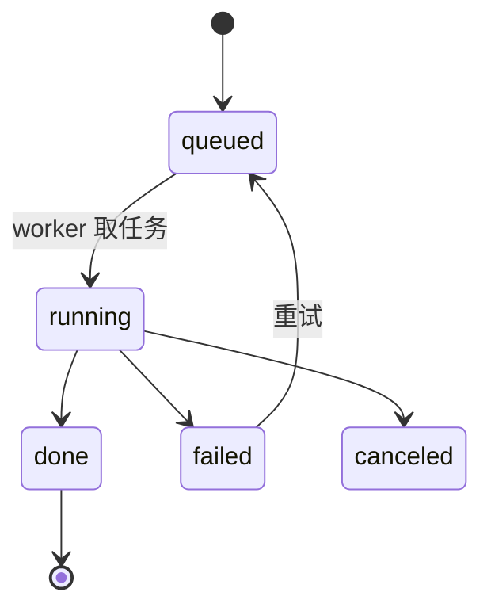

# 详细开发方案（编码前必读）

| 项 | 内容 |
|---|---|
| 版本 | v1.0 / 2026-10-31 |
| 读者 | 实现者 |
| 上游 | [01 技术选型](01-技术选型报告.md) · [02 PRD](02-PRD.md) · [04 重叠与声纹](04-重叠说话与声纹登记设计.md) · [05 热词](05-热词登记设计.md) |
| 本轮新增 | 长音频（1/2/5 小时）资源模型、OpenAI 兼容 API、说话人分离架构调整 |
| 状态 | 可直接据此开工；标注「待验证」的项需先做 PoC |

---

## 0. 本方案相对早期设计的三个调整

| # | 调整 | 原因 | 影响 |
|---|---|---|---|
| **A** | **说话人分离从「ASR 内置」改为「独立阶段」** | FunASR 内置的 `spk_model` 是**整文件一次聚类**，无法跨分片、无法重算、无法干预；5 小时音频必须能分片处理 | ASR 只出「文本 + 时间戳」，我们自己对 VAD 段抽 CAM++ embedding 并全局聚类；慢约 1–2% RTF，换来可合并、可重跑、可跨片 |
| **B** | **长音频走「VAD 全局 → 分窗 ASR → 全局聚类」三段式** | 一次性把 5 小时 PCM 喂给模型，内存与失败恢复都不可控 | 新增 `vad_plan` 中间产物；ASR 可按窗口断点续跑 |
| **C** | **新增 OpenAI 兼容 API，默认只做 ASR（不含 LLM 纠错）** | 兼容接口必须**同步返回**，LLM 纠错是分钟级操作，放进去必然超时 | API 返回「ASR + 标点 + 说话人」；纠错/纪要走内部任务与异步扩展接口 |

---

## 1. 系统架构

### 1.1 进程模型

```
┌─────────────┐        ┌──────────────┐        ┌─────────────┐
│  api 进程    │        │  SQLite(WAL) │        │ worker 进程  │
│  FastAPI    │◀──────▶│  jobs/queue  │◀──────▶│  单线程泵     │
│  + SSE      │        │  results     │        │  串行执行     │
└──────┬──────┘        └──────────────┘        └──────┬──────┘
       │                                              │
       ▼                                              ▼
   浏览器 / 外部 API 调用                        FunASR / CAM++ / Ollama / ffmpeg
```

- **两个进程**：`tingji-api`（Web + API）与 `tingji-worker`（处理）。
- 通信只走 SQLite（WAL 模式），不引入 Redis/RabbitMQ。
- 开发模式支持 `--all-in-one`（线程内起 worker），生产建议分离（worker 崩溃可独立重启，不影响 Web）。
- **worker 并发度 = 1**（内存与模型单例约束），多任务排队。

### 1.2 任务状态机



阶段（`stage`）：

```
ingested → planned → normalized → transcribed → diarized → identified
        → cleaned → hotworded → corrected → summarized → archived → done
```

| 阶段 | 产物文件 | 说明 |
|---|---|---|
| `planned` | `plan.json` | VAD 全局切分结果 + 分窗计划（**新增**） |
| `normalized` | `16k.wav`、`preview.m4a` | 归一化 |
| `transcribed` | `segments.json` | 文本 + 时间戳（**不含说话人**） |
| `diarized` | `diarize.json` | 每段 embedding、聚类、短句回填、簇合并 |
| `identified` | `speakers.json` | 声纹比对结果 |
| `cleaned` | `cleaned.json` | 规则清理 |
| `hotworded` | `hotworded.json` | L2 热词替换（ASR 后一次） |
| `corrected` | `corrected.json` | LLM 纠错（可选），再跑一次 L2 |
| `summarized` | `summary.json` | 纪要 + 打标 |
| `archived` | `export.json` | Obsidian 写入 + 源清理 |

> 每个阶段都是**幂等**的：输入哈希 + 配置哈希不一致则重跑该阶段及其下游。

---

## 2. 模块与文件职责

```
app/
├── main.py                 # FastAPI 装配、生命周期
├── settings.py             # pydantic-settings，读 config.yaml + 环境变量
├── db.py                   # 连接池、迁移、Repository
├── models.py               # Pydantic 模型（Job/Segment/Speaker/Hotword…）
├── errors.py               # 错误码枚举 + PipelineError
├── logging.py              # structlog JSON 日志（脱敏）
├── worker.py               # 主循环：取任务 → 跑 stage → 更新 DB
├── pipeline/
│   ├── base.py             # Stage 协议、JobContext
│   ├── s0_ingest.py        # 校验、哈希、入库
│   ├── s1_normalize.py     # ffmpeg 归一化 + 预览 m4a
│   ├── s2_plan.py          # VAD 全局切分 + 分窗计划         ★新增
│   ├── s3_transcribe.py    # 分窗 ASR（可断点）               ★调整
│   ├── s4_diarize.py       # embedding + 聚类 + 回填 + 合簇    ★调整
│   ├── s5_identify.py      # 声纹比对
│   ├── s6_clean.py         # 规则清理（填充词/重复）
│   ├── s7_hotword.py       # 热词 L2
│   ├── s8_correct.py       # LLM 纠错（分批/选择性/校验）
│   ├── s9_summarize.py     # 纪要 + 打标
│   └── s10_archive.py      # Obsidian 原子写 + 清理源
├── engines/
│   ├── asr_funasr.py       # 单例加载、窗口批量解码
│   ├── moss_asr.py         # 可选：重叠段重转写 / 高质量模式
│   ├── speaker.py          # CAM++ ONNX embedding（sherpa-onnx）
│   ├── clusering.py        # 聚类（层次/谱）+ 质心 + 合并
│   ├── llm_ollama.py       # think=false、JSON mode、重试、keep_alive
│   └── ffmpeg.py           # 探测、切窗、转码
├── text/
│   ├── fillers.py          # 填充词规则
│   ├── repeats.py          # 重复/结巴
│   ├── hotwords.py         # L1/L2 组装、匹配、统计
│   └── validate.py         # 纠错输出校验（seg_id/长度/时间戳）
├── obsidian/
│   ├── render.py           # Jinja2 模板
│   ├── writer.py           # 原子写、幂等、文件名清洗
│   └── tags.py             # 标签治理
├── api/
│   ├── jobs.py / events.py / media.py
│   ├── hotwords.py / voices.py / settings_api.py
│   └── openai_compat.py    # /v1/audio/transcriptions 等    ★新增
└── security.py             # API Key、限流、绑定策略
```

---

## 3. 数据模型（完整 DDL）

```sql
PRAGMA journal_mode=WAL;

CREATE TABLE jobs (
  id            TEXT PRIMARY KEY,
  source_name   TEXT NOT NULL,
  source_sha256 TEXT UNIQUE,
  size_bytes    INTEGER,
  duration_sec  REAL,
  status        TEXT NOT NULL,          -- queued|running|done|failed|canceled|duplicate
  stage         TEXT,
  progress      INTEGER DEFAULT 0,
  error_code    TEXT, error_message TEXT,
  degraded      INTEGER DEFAULT 0,
  retry_count   INTEGER DEFAULT 0,
  source        TEXT,                   -- watch|upload|api
  api_key_id    TEXT,                   -- 外部调用时归属
  config_hash   TEXT,
  created_at TEXT, started_at TEXT, finished_at TEXT
);
CREATE INDEX ix_jobs_status ON jobs(status);
CREATE INDEX ix_jobs_created ON jobs(created_at);

CREATE TABLE plan (                      -- VAD 全局切分 + 分窗计划
  job_id TEXT PRIMARY KEY,
  total_sec REAL,
  vad_segments TEXT,                     -- JSON [{start_ms,end_ms}]
  windows TEXT,                          -- JSON [{idx,start_ms,end_ms,path}]
  window_count INTEGER,
  created_at TEXT
);

CREATE TABLE segments (
  id            INTEGER PRIMARY KEY AUTOINCREMENT,
  job_id        TEXT NOT NULL,
  idx           INTEGER NOT NULL,
  start_ms      INTEGER NOT NULL,
  end_ms        INTEGER NOT NULL,
  raw_text      TEXT NOT NULL,
  clean_text    TEXT,
  final_text    TEXT,
  spk_cluster   INTEGER,
  speaker_id    TEXT,
  overlap_flag  TEXT,                    -- none|suspected|low_quality
  overlap_score REAL,
  quality       TEXT,                    -- ok|suspect|low_quality
  char_rate     REAL,
  edited_by_user INTEGER DEFAULT 0,
  UNIQUE(job_id, idx)
);
CREATE INDEX ix_segments_job ON segments(job_id);

CREATE TABLE segment_embeddings (
  job_id TEXT, seg_idx INTEGER, vector BLOB,  -- 192 × float32
  PRIMARY KEY (job_id, seg_idx)
);

CREATE TABLE diarization (
  job_id TEXT PRIMARY KEY,
  num_clusters INTEGER, merged_from TEXT,   -- JSON 记录合并历史
  centroids BLOB,                            -- JSON/float32
  created_at TEXT
);

CREATE TABLE speakers (id TEXT PRIMARY KEY, display_name TEXT, note_path TEXT, created_at TEXT);

CREATE TABLE voiceprints (
  id INTEGER PRIMARY KEY AUTOINCREMENT,
  speaker_id TEXT, session_id TEXT, kind TEXT,    -- sentence|centroid
  model TEXT, dim INTEGER, vector BLOB,
  quality REAL, device_tag TEXT, created_at TEXT
);

CREATE TABLE cluster_matches (
  job_id TEXT, cluster_id INTEGER, speaker_id TEXT,
  score REAL, margin REAL, decision TEXT,         -- auto|confirmed|rejected
  PRIMARY KEY(job_id, cluster_id)
);

CREATE TABLE hotwords (
  id INTEGER PRIMARY KEY AUTOINCREMENT,
  term TEXT NOT NULL UNIQUE, pinyin TEXT, type TEXT,
  aliases TEXT, weight REAL DEFAULT 1.0,
  scope TEXT DEFAULT 'global', enabled INTEGER DEFAULT 1,
  source TEXT, note TEXT, created_at TEXT, updated_at TEXT
);

CREATE TABLE hotword_stats (
  hotword_id INTEGER, job_id TEXT, layer TEXT,
  matched_at INTEGER, original TEXT, score REAL,
  reverted INTEGER DEFAULT 0, created_at TEXT,
  PRIMARY KEY(hotword_id, job_id, layer, matched_at)
);

CREATE TABLE summaries (job_id TEXT PRIMARY KEY, model TEXT, json TEXT, markdown TEXT,
                        tokens_in INTEGER, tokens_out INTEGER, created_at TEXT);

CREATE TABLE exports (job_id TEXT PRIMARY KEY, note_path TEXT, transcript_path TEXT,
                      audio_path TEXT, srt_path TEXT, txt_path TEXT, tags TEXT, created_at TEXT);

CREATE TABLE events (id INTEGER PRIMARY KEY AUTOINCREMENT, job_id TEXT, ts TEXT,
                     level TEXT, stage TEXT, message TEXT, payload TEXT);
CREATE INDEX ix_events_job ON events(job_id, ts);

CREATE TABLE api_keys (
  id TEXT PRIMARY KEY, name TEXT, key_hash TEXT UNIQUE,
  scopes TEXT, rate_limit_per_min INTEGER DEFAULT 10,
  max_concurrent INTEGER DEFAULT 1, enabled INTEGER DEFAULT 1,
  created_at TEXT, last_used_at TEXT
);

CREATE TABLE settings (key TEXT PRIMARY KEY, value TEXT);
```

---

## 4. 核心算法

### 4.1 长音频三段式处理（支持 1/2/5 小时）

**问题**：一次性把 5 小时 PCM（≈576MB）交给 FunASR，内存与失败恢复都不可控；且内置说话人聚类无法跨片。

**方案**：

```
Stage s2_plan
  1) ffmpeg 解码为 16k mono wav（流式，不整读）
  2) FunASR VAD 模型单独跑一遍（仅 VAD，不跑 ASR）→ vad_segments
  3) 按"累计语音时长 ≈ 20–30 分钟"聚成窗口 windows[]
     （在静音处切，窗口不跨长静音）

Stage s3_transcribe
  4) 逐窗口送 ASR（window 内 batch_size_s=300）
  5) 每窗口结果落盘 work/<job>/asr/w<idx>.json（可断点）
  6) 合并所有窗口 → segments（保持时间戳全局顺序）

Stage s4_diarize
  7) 对每个 segment 抽 CAM++ embedding（1s 起算；<1s 段继承）
  8) 全局聚类（层次聚类，cosine 距离，阈值 0.35 → 距离阈值）
  9) 双轮质心：剔除重叠嫌疑段 → 重算质心 → 重新分配
 10) 簇合并（质心 cosine ≥0.72 连通分量）
 11) 短句回填（<1s 且前后同簇）
```

**为什么 VAD 单独跑一次**：VAD 模型只有 3.9MB、极快（实测 73 分钟 <10s），却能把「切分」与「识别」解耦，让 ASR 可分窗、可续跑。这是长音频可扩展的关键。

**跨片一致性**：因为说话人聚类在**所有窗口完成后全局执行**，不存在"跨片同一人被拆开"的问题。

### 4.2 全局聚类与合并

```python
def diarize(embs, times):                     # embs: (N,192) L2-normalized
    long_mask = np.array([d >= 1.0 for d in durations])   # ≥1s 参与聚类
    Z = linkage(embs[long_mask], method="average", metric="cosine")
    labels = fcluster(Z, t=0.35, criterion="distance")

    # 双轮质心
    cents = centroids(embs[long_mask], labels)
    overlap = overlap_suspects(embs, cents)   # 边距法 + 段内一致性
    cents2 = centroids(embs[long_mask & ~overlap], labels[~overlap])
    labels = reassign(embs, cents2)

    # 簇合并（连通分量）
    labels = merge_by_centroid(labels, embs, threshold=0.72)

    # 短句回填
    labels = fill_short(labels, durations, times)
    return labels
```

**阈值起点**：层次聚类 `t=0.35`（cosine 距离）、合簇 `0.72`、认名 `0.72 + margin 0.05`。**全部需用真实数据校准**（当前仅 1 段真实会议样本）。

### 4.3 热词三层

```python
# L1：解码偏置（≤50 条，按 weight 降序）
hot_l1 = " ".join(h.term for h in top_hotwords(50))
res = asr.generate(input=win, hotword=hot_l1)

# L2：文本替换（≤2000 条，ASR 后 + LLM 后各一次）
matcher = build_postprocess_hotword_matcher(
    {alias: term for h in hotwords for alias in ([h.term] + h.aliases)},
    postprocess_hotword_threshold=0.85,
)
text, matches = matcher.apply_text(text)
record_stats(matches)          # 供 /hotwords 命中与误报统计

# L3：术语表注入纠错 prompt（按批筛选，只注入本批可能相关的）
```

### 4.4 纠错：选择性 + 强校验

**选择性纠错**（长音频必需）：只把「可能有问题」的批次送 LLM。

```python
def need_llm(text, segs):
    return (
        has_latin(text) or has_digits(text)
        or has_repeat_ngram(text)
        or any(s.char_rate < 3 for s in segs)
        or any(h.term in text for h in hotwords)
    )
```

实测纠错全量耗时 1434 秒（0.069 秒/字）。按约 **50%** 批次被命中（含英文术语/数字/低语速/热词命中），可**节省约一半**的 LLM 时间。

**前置过滤**（长音频实测补充）：原文有效字符 <4 的批次**不送 LLM**（纯标点/噪声段），直接丢弃。真实会议中 350 批里有 **26 批**属于这种情况。

**输出过滤**（真实会议踩到的坑）：模型会对着"无内容输入"输出一段**解释性文字**（"由于您提供的原文仅包含标点符号…"）。必须：

```python
META_START = ("（注", "(注", "由于您提供", "抱歉", "作为AI", "我无法", "很抱歉")
META_HARD  = ("请补充完整", "无法进行校对", "暂无可输出", "我将立即为您", "无法提取有效")

def sanitize(fixed, raw):
    t = fixed.strip()
    if t.startswith(META_START) or any(h in t for h in META_HARD):
        return raw                                   # 整段解释 → 回退原文
    t = re.sub(r"[（(][^（）()]*(原文|校对|补充|无法|转写)[^（）()]*[）)]\s*$", "", t).strip()
    return t if len(MEANING.findall(t)) >= 2 else raw
```

真实会议 350 批中触发 17 次，其中 12 次是"正文 + 尾部注释"，只剥离注释即可；其余回退原文。

**时间戳归属（关键约束）**

```python
# 输入：一批 seg_id + 文本 + 时间
# 输出：段落列表，每段必须带 seg_id 区间
{"seg_from": 12, "seg_to": 17, "text": "整理后的段落……"}

# 落库时 ONLY 用 ASR 边界推导时间，绝不采信模型输出的数字
start_ms = segments[seg_from].start_ms
end_ms   = segments[seg_to].end_ms
```

- 模型输出里若出现任何 `\d{1,2}:\d{2}` 形式的时间 → 直接判为不合规、回退原文。
- 段落时间必须单调：`next.start_ms >= cur.end_ms`，否则整批回退。
- 整理稿落 `segments.final_text` + `seg_from/seg_to`；原文轨（`raw_text`）的逐句时间**永不覆盖**。

**校验器**（拒绝不合规输出）：

```python
def validate(raw_ids, out_items, originals):
    assert {x["seg_id"] for x in out_items} == set(raw_ids)     # 不许增删
    for it in out_items:
        ratio = len(it["text"]) / max(len(originals[it["seg_id"]]), 1)
        assert 0.5 <= ratio <= 1.6                              # 长度变化上限
        assert no_new_numbers(it["text"], originals[it["seg_id"]])  # 不许造数字
    assert timestamps_unchanged(...)
```

任一条不满足 → 该批回退原文并记 `E_LLM_INVALID`。

**实测效果**（全量 350 批、1434 秒）：填充词 `嗯/呃/啊` 368→69（−81%）、`那个` 279→84（−70%）、`sars` 12→0（同时 `SaaS` 出现 23 次），字数 22,255→20,011（−10%）。

### 4.5 长段切分与低质量段

```python
def split_long(seg, max_sec=30.0, wav=None):
    if seg.duration <= max_sec: return [seg]
    # 在段内能量谷处找切点（帧能量 -25dB 分位），保证每片 ≤30s
    ...

def quality_flag(text, dur):
    rate = len(text) / max(dur, 0.001)
    if dur > 10 and rate < 1.0:  return "low_quality"   # 不进正文
    if dur > 10 and rate < 3.0:  return "suspect"       # 降权、不参与聚类
    return "ok"
```

---

## 5. 接口契约

### 5.1 内部 API（Web）

| 方法 | 路径 | 说明 |
|---|---|---|
| GET | `/api/health` | 依赖/模型/LLM/vault 状态 |
| GET | `/api/jobs` | 列表（分页、状态筛选） |
| POST | `/api/jobs/upload` | 上传入队 |
| GET | `/api/jobs/{id}` | 详情 |
| GET | `/api/jobs/{id}/transcript?track=raw\|clean\|final&format=json\|md\|srt\|txt` | 逐字稿 |
| PATCH | `/api/jobs/{id}/segments/{idx}` | 改文本/归属 |
| POST | `/api/jobs/{id}/speakers/{cluster}` | 改名/合并 |
| POST | `/api/jobs/{id}/rerun` | `{from_stage}` |
| GET | `/api/events?job_id=` | SSE |
| GET | `/api/media/{id}/audio` | Range 音频流 |
| CRUD | `/api/hotwords` | 热词（列表/新建/改/删/批量导入/试一段） |
| CRUD | `/api/voices` | 声纹库 + 登记会话 |
| GET/PUT | `/api/settings` | 设置 |

### 5.2 OpenAI 兼容 API（外部调用）

**结论：可以做，但必须解决"同步 vs 长任务"的矛盾。**

#### 5.2.1 端点

| 方法 | 路径 | 说明 |
|---|---|---|
| GET | `/v1/models` | 返回 `tingji-asr`、`tingji-asr-hq`、`whisper-1`（别名） |
| POST | `/v1/audio/transcriptions` | 主接口（multipart） |
| GET | `/v1/audio/transcriptions/{id}` | **扩展**：异步任务查询 |
| DELETE | `/v1/audio/transcriptions/{id}` | **扩展**：取消 |

#### 5.2.2 请求字段（与 OpenAI 对齐）

| 字段 | 支持 | 说明 |
|---|---|---|
| `file` | ✅ | 必填，≤ `max_upload_gb`（默认 4GB） |
| `model` | ✅ | `tingji-asr`（默认）/`tingji-asr-hq`（MOSS） |
| `language` | ✅ | `zh`（默认自动） |
| `prompt` | ✅ | 作为**上下文/热词**注入（≤500 字） |
| `response_format` | ✅ | `json` / `text` / `srt` / `vtt` / `verbose_json` |
| `temperature` | ⚠️ | 接受但忽略（解码是确定性的），记日志 |
| `timestamp_granularities[]` | ✅ | `segment`（默认）/ `word`（词级） |
| `speaker_labels` | ⚠️ 扩展 | 非标准字段；`verbose_json` 中 `segments[].speaker` |

#### 5.2.3 响应

`json`：
```json
{"text": "各位同事，我们今天的周会……"}
```

`verbose_json`：
```json
{
  "task": "transcribe",
  "language": "zh",
  "duration": 4375.6,
  "text": "……",
  "segments": [
    {"id": 0, "start": 66.2, "end": 71.8, "text": "……", "speaker": "speaker_1"}
  ]
}
```

> `speaker` 是我们加的扩展字段；OpenAI 官方 `verbose_json` 没有它，但多出的字段不会让标准客户端报错。

#### 5.2.4 同步 / 异步规则（关键）

| 音频时长 | 行为 |
|---|---|
| ≤ `sync_max_audio_sec`（默认 **1800s / 30 分钟**） | 同步返回结果（预计 2–3 分钟） |
| > 1800s | 返回 **202 Accepted** + `Location: /v1/audio/transcriptions/{id}`，body：`{"id":"...","status":"queued","estimated_sec":1800}` |

判定依据是 `ffprobe` 读到的时长（毫秒级，不阻塞）。

**为什么定 30 分钟**：实测 RTF 0.078 → 30 分钟音频约 2.3 分钟处理；多数 HTTP 客户端默认超时 60–300s，再长就会断开。

**兼容性取舍**：真实 OpenAI 客户端拿到 202 会当成错误。因此：
- 默认对 >30 分钟音频返回 202（**明确文档说明**）；
- 提供 `?async=false` 强制同步（用于自建脚本，需自行设长超时）；
- 我们自己的工具与 Web 一律走内部 API，不用这个接口。

#### 5.2.5 鉴权与限流

```http
Authorization: Bearer tk_live_xxxxxxxx
```

- Key 存 `sha256(key + salt)`，明文只在创建时显示一次。
- 默认**只绑定 `127.0.0.1`**；开放到局域网需显式 `server.bind: 0.0.0.0` + 设置 `require_api_key: true`。
- 限流：每 Key 默认 10 次/分钟、并发 1；超限返回 `429` + `Retry-After`。
- 文件校验：扩展名白名单 + `ffprobe` 能解析 + 时长 > 0；不接收 URL。

#### 5.2.6 兼容性验证（开工后必做）

```python
from openai import OpenAI
c = OpenAI(base_url="http://127.0.0.1:8000/v1", api_key="tk_live_xxx")
r = c.audio.transcriptions.create(
    model="tingji-asr", file=open("a.wav","rb"),
    response_format="verbose_json",
)
print(r.text, [(s.start, s.end, s.text) for s in r.segments])
```

验收：官方 SDK 不改一行代码可跑通 `json` / `text` / `srt` / `verbose_json` 四种格式。

#### 5.2.7 明确的"不兼容"清单

| 项 | 说明 |
|---|---|
| `/v1/audio/translations` | 不做（无翻译需求） |
| 流式 `stream=true` | 不做（离线批处理） |
| `logprobs` | 不提供 |
| 20MB 限制 | 不跟随（OpenAI 限制 25MB），我们支持到 4GB |
| 计费/组织字段 | 不提供 |

---

## 6. 长音频资源模型（1 / 2 / 5 小时）

### 6.1 实测基线

73 分钟真实会议：**341s 处理 / 4.87GB 峰值 / 12.8× 实时 / 20,771 字**。

### 6.2 线性外推（标 * 为推算）

| 时长 | ASR | 说话人（VAD+嵌入+聚类） | LLM 纠错（选择性 45%） | 纪要 | **合计** | 峰值内存 | 中间磁盘 |
|---|---|---|---|---|---|---|---|
| 1h | 4.7 min | ~1 min | **~9.4 min** | 1.5 min | **≈ 17 min** | 5.0GB | ~200MB |
| 2h | 9.4 min | ~2 min | ~18.8 min | 3 min | **≈ 33 min** | 5.2GB | ~400MB |
| 5h | 23.4 min | ~5 min | ~47 min | 7.5 min | **≈ 83 min** | 5.5GB* | ~1.0GB |

> LLM 成本按实测 **0.069 秒/字**（全量纠错：350 批 / 1434 秒 / 20,771 字）+ 选择性 50% 估算。
> 不做 LLM 纠错时（`mode=fast`）：1h ≈ 7 min、2h ≈ 14 min、5h ≈ 36 min。

### 6.3 内存随时长增长的原因与上限

| 组件 | 是否随时长增长 | 说明 |
|---|---|---|
| FunASR 模型 | ❌ 恒定 | 4 个模型约 2.1GB |
| 解码 batch | ❌ 恒定 | `batch_size_s=300` 限制单批 |
| segments 列表 | ✅ 线性 | 5h ≈ 7,300 段 × ~300B ≈ **2MB**，可忽略 |
| 说话人 embedding | ✅ 线性 | 7,300 × 192 × 4B ≈ **5.6MB** |
| 中间 wav | ❌ 磁盘 | 16k mono = **115MB/小时** |
| **MOSS（若启用）** | ✅ **85MB/分钟** | 1h≈5GB、2h≈10GB、**5h≈25GB → 16GB 机器跑不了** |

**结论**：主链路（FunASR + CAM++ + Ollama）内存**基本恒定在 5GB 左右**，可支撑 5 小时以上。MOSS 必须限制在 **≤1 小时**，更长必须分片（会割裂说话人，不推荐）。

### 6.4 磁盘预算

| 项目 | 1h | 2h | 5h |
|---|---|---|---|
| 16k wav（处理中） | 115MB | 230MB | 576MB |
| 预览 m4a 64k | 29MB | 58MB | 144MB |
| 中间 JSON | ~5MB | ~10MB | ~25MB |
| **单任务峰值** | **~150MB** | **~300MB** | **~750MB** |

守卫：处理前要求剩余 ≥ 单任务预估 × 3 + 5GB。

### 6.5 超时与进度

- 单阶段超时：`asr: 时长 × 0.3s`（≈3.3× 余量）、`llm_correct: 字数 × 0.15s`。
- **长音频的纪要必须分层**：先按 30 分钟块各出一段摘要（每块 ~8k 字 → 单次调用可控），再把这些摘要合并成总纪要。否则 5 小时 ≈ 8.5 万字，单次 prompt 就 5.7 万 token，既慢又容易截断。
- 进度：`ASR` 按已处理窗口数；`纠错` 按已完成批次数；两者都能给出"预计剩余"。

---

## 7. 并发与资源守卫

```python
GUARDS = {
    "max_concurrency": 1,          # 全链路串行
    "min_free_disk_gb": 5,
    "max_rss_gb": 10,
    "llm_unload_after": True,      # keep_alive=0
}
```

| 触发 | 动作 |
|---|---|
| 磁盘 <5GB | 暂停取新任务，Web 顶部红色横幅 |
| RSS >10GB | 中止当前任务，标 `E_OOM`，释放模型 |
| Ollama 不可达 | **降级**：跳过纠错，其余照常，标 `degraded=1` |
| 模型缺失 | 暂停队列，提示 `make warmup` |

---

## 8. 配置（新增项）

```yaml
long_audio:
  window_sec: 1500            # 每个 ASR 窗口约 25 分钟语音
  max_segment_sec: 30         # 单段超过则二次切分
  vad_only_first: true        # 先跑纯 VAD 再分窗

diarization:
  min_cluster_segment_sec: 1.0
  linkage_threshold: 0.35     # cosine 距离
  merge_threshold: 0.72
  overlap_detect: true

correction:
  selective: true             # 只纠可能出错的批次
  batch_chars: 700
  max_length_ratio: 0.5
  model: qwen3.5:9b-q4_K_M

server:
  bind: 127.0.0.1
  port: 8000
  require_api_key: false      # 仅当 bind 非回环时强制 true

openai_api:
  enabled: true
  sync_max_audio_sec: 1800
  default_model: tingji-asr
  max_upload_gb: 4
  rate_limit_per_min: 10

asr:
  provider: funasr            # funasr | moss | moss_hq
  moss_max_audio_sec: 3600    # 超过则禁用 MOSS
```

---

## 9. 错误码

| 码 | 含义 | HTTP（外部 API） |
|---|---|---|
| `E_DECODE` | 无法解码 | 400 |
| `E_TOO_LARGE` | 超过大小上限 | 413 |
| `E_AUTH` | Key 无效 | 401 |
| `E_RATE_LIMIT` | 超限 | 429 |
| `E_BUSY` | 队列已满 | 503 + Retry-After |
| `E_LLM_DOWN` | LLM 不可达（降级） | 成功但 `degraded` |
| `E_LLM_INVALID` | 纠错输出校验失败 | 内部回退 |
| `E_VAULT_UNWRITABLE` | vault 不可写 | 500 |
| `E_OOM` | 内存超限 | 500 |
| `E_NO_SPEECH` | 无人声 | 200 + 空 segments |

---

## 10. 测试计划

| 层 | 用例 | 门槛 |
|---|---|---|
| 单元 | 长段切分、短句回填、簇合并、热词匹配、校验器、文件名清洗 | 覆盖率 ≥75% |
| 集成 | 每阶段 fixture（含 1 段 10 分钟真实音频） | 全通过 |
| 长音频 | 1h / 2h / 5h 合成拼接音频（`ffmpeg -stream_loop`） | 不 OOM、可断点续跑、进度单调 |
| 兼容性 | `openai-python` SDK 四种 response_format | 全部跑通 |
| 安全 | 无 Key 访问、超限、超大文件、非法格式 | 全部拒绝且不落盘 |
| 时间戳 | 整理稿段落时间全部可在 ASR 边界找到；单调无重叠；覆盖率 ≥95% | 自动化断言 |
| 质量回归 | 基准集 CER / 说话人误差 / 热词命中 | 见 PRD |
| 断网 | 全流程离线 | 成功 |

**长音频测试的省时技巧**：用 `ffmpeg -stream_loop 4 -i meeting_16k.wav` 把 73 分钟音频拼成 6 小时，只验证"内存不涨、可续跑"，不验证内容准确性。

---

## 11. WBS（在 03 的基础上增量）

| 里程碑 | 新增任务 | 工时 |
|---|---|---|
| M1 | 长段切分、低质量段过滤、选择性纠错框架 | +2 天 |
| M2 | 独立说话人阶段（embedding + 全局聚类 + 合簇 + 回填） | +3 天 |
| M4 | OpenAI 兼容 API（含鉴权、限流、异步扩展） | +3 天 |
| M5 | 长音频压测（1/2/5h）、断点续跑、资源守卫 | +2 天 |
| | **合计增量** | **+10 天** |

**总工期**：26–31 天 → **36–41 天**（单人）。若砍掉 OpenAI API 与 MOSS，可回到 30 天左右。

---

## 12. 运行与运维

```bash
# 首次
make warmup        # 拉模型 + 自检
make dev           # all-in-one，127.0.0.1:8000

# 生产
tingji-api  --config config/config.yaml
tingji-worker --config config/config.yaml

# 自检
tingji selfcheck   # 模型 / LLM / vault / ffmpeg / 磁盘
```

- 日志：`logs/app.jsonl`（结构化、脱敏），按天轮转。
- 备份：`data/app.db` + `config/`；`work/` 与 `output/` 可重建。
- 升级：DB 迁移用 `schema_version` 表，向前兼容一个版本。

---

## 13. 开工顺序（建议）

1. **D1**：仓库骨架 + DB 迁移 + 配置 + `s1_normalize`（能处理一个文件）
2. **D2–D3**：`s2_plan` + `s3_transcribe`（含长段切分、窗口续跑）
3. **D4–D5**：`s4_diarize`（embedding + 聚类 + 合簇 + 回填）+ 详情页逐字稿
4. **D6**：热词 L1/L2 + `/hotwords` 最小可用（增删改 + 试一段）
5. **D7–D8**：`s6_clean` + `s8_correct`（选择性 + 校验）
6. **D9**：`s9_summarize` + `s10_archive`
7. **D10–D11**：Web（队列/详情/SSE）+ 声纹库
8. **D12–D13**：OpenAI 兼容 API + 鉴权 + 限流
9. **D14**：长音频压测 + 断点恢复 + 资源守卫
10. **D15**：基准集回归 + 文档

> 每一步都要求「能跑通 + 有测试」，不追求一次做完。
